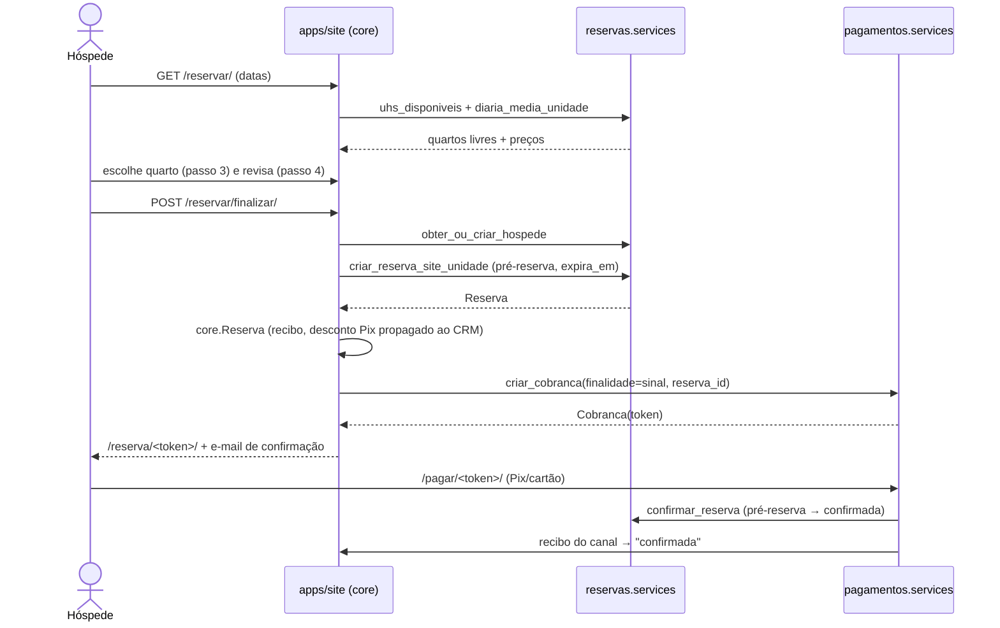
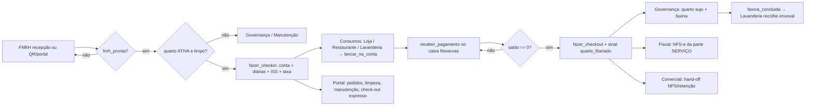
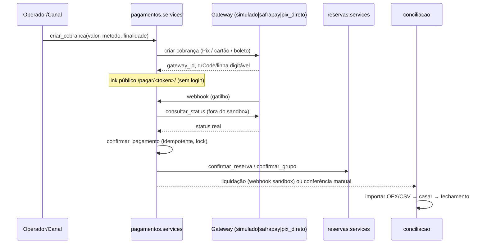
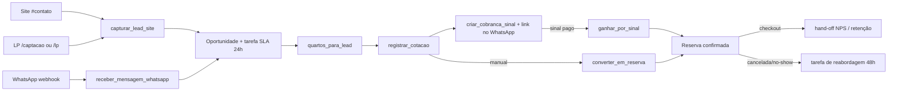

# Módulos e Fluxos

> **Versão do manual:** descreve o painel de governança publicado na base revisada.
> O redesenho gráfico e os ajustes mais recentes de interação estão separados no
> [quadro de mudanças locais](ESTADO_ATUAL.md#melhorias-locais-ainda-não-publicadas-na-data-da-revisão).

Referência de desenvolvedor que complementa o [README](../README.md): cada módulo do
CRM/PMS + site da **Pousada Vô Testa** (24 quartos de hospedagem + unidades de day use
`DAY-0N`, Itá/SC) e os fluxos ponta a ponta. Conferido contra o código da branch `dev`
em 21/10/2026. O [Estado atual](ESTADO_ATUAL.md) identifica a base publicada, as
melhorias locais ainda não publicadas e limites das integrações. Prefira localizar
funções/classes pelos nomes; os números de linha de referências antigas variam.

**Convenções que valem para todo o capítulo A**

- Cada módulo contratável é um app Django em `apps/`. O catálogo (código, grupo de menu,
  ordem, descrição, rota principal) está em `apps/nucleo/modulos.py`; a ativação por
  cliente está na tabela `nucleo.ModuloContratado`, consultada por
  `modulo_ativo(codigo)` (`apps/nucleo/models/usuarios.py`).
- **Dependências declaradas** = `DEPENDENCIAS` em `apps/nucleo/modulos.py`. Módulo sem
  entrada ali não exige nenhum outro.
- Controle de acesso (`apps/nucleo/permissoes.py`):
  - `@requer_modulo(Modulo.X)` → módulo inativo = **404**; usuário sem o módulo em
    `Usuario.modulos` = **403**; superusuário passa.
  - `@requer_area(*codigos)` → áreas-core do núcleo (`apps/nucleo/areas.py`), variádico
    (passa quem tiver **qualquer** uma).
  - `@requer_gerencia` → `eh_gerente()` = `is_staff` ou `is_superuser`.
- Rotas do CRM ficam sob `/crm/…` (`config/urls.py`); o site público em `/`, o portal do
  hóspede em `/hospede/`, LPs em `/lp/` e `/captacao/`, webhooks em `/whatsapp/webhook/`,
  `/crm/pagamentos/webhook/` e `/crm/fiscal/webhook/`.
- Dinheiro é sempre `DecimalField`. `MovimentoCaixa`, `MovimentoEstoque`,
  `LancamentoConta`, `MovimentoEnxoval` e `TrilhaAuditoria` são **imutáveis** (o `save()`
  de edição levanta `ValidationError`); correção = movimento inverso.
- Os serviços do núcleo usados por quase todos os módulos:
  `receber_no_caixa`, `estornar_movimento`, `registrar_auditoria`, `saldo`,
  `registrar_entrada`, `registrar_saida`, `transferir`, `ajustar`,
  `devolver_ao_estoque`, `posicao_estoque` (reexportados em
  `apps/nucleo/models/__init__.py`).

---

# A. Módulos

## A.1 Reservas — `apps/reservas` (label `reservas`)

**Responsabilidade.** Fonte de verdade única da **disponibilidade** e da **conta da
hospedagem** (folio). Cobre o ciclo da reserva (orçamento → saída), tarifa/motor de
preço, grupos (bloco de quartos), FNRH/BOH, estoque de colchões extra e berço.

- **Código:** `Modulo.RESERVAS` · **Dependências declaradas:** nenhuma.
- É dependência declarada de Governança, Manutenção, APP/Site, CRM do Hóspede e Canais.

### Models principais (`apps/reservas/models.py`)

| Model | Para que serve | Campos/estados relevantes |
|---|---|---|
| `Tarifa` | matriz `TipoUH × classificação de temporada` | `valor`; unique (`tipo_uh`,`classificacao`) |
| `TarifaUnidade` | preço por **quarto** × classificação | `valor` (base 2 adultos), `pessoa_adicional`; unique (`uh`,`classificacao`) |
| `TarifaTemporada` | preço por quarto numa **temporada específica** (Natal ≠ Ano Novo) | `valor`, `pessoa_adicional`; unique (`temporada`,`uh`) |
| `Reserva` | a reserva | ciclo de estados, `canal`, `faturamento`/`titular`, lotação por faixa, arranjo de camas, `expira_em`, bloco FNRH; `valor_diaria` (média) + `valor_hospedagem` (total exato cotado); `valor_retido` (cancelamento) |
| `GrupoReserva` | reserva-mãe (bloco de quartos) | `rotulo`, `titular`, `checkin/checkout`, `expira_em`, `encerrado_em`; status **derivado** das filhas (`situacao()`) |
| `RestricaoVenda` | regra de venda por período (Réveillon, feriados) | `inicio`/`fim` (datas de NOITE, inclusive), escopo casa / `tipo_uh` / `uh` (CheckConstraint: nunca os dois), `min_noites` ("min stay through": vale se qualquer noite cair no período; o maior mínimo vence), `fechado_chegada`, `fechado_saida`, `parar_vendas`, `ativa` |
| `ContaHospedagem` | folio: ou de um quarto, ou do grupo | `status` aberta/fechada; check-constraint `conta_reserva_xor_grupo` |
| `LancamentoConta` | item do folio | `tipo` diaria/consumo/servico/taxa/desconto × `natureza` SERVIÇO/CONSUMO (obrigatória); imutável. `taxa` = ISS e taxa de turismo (lançados no check-in; fora da base da NFS-e). `competencia` = o dia a que o item se refere: a **noite**, na diária (todas lançadas no check-in, uma por noite); o dia do lançamento, no resto |
| `FechamentoDiario` | fechamento do dia | um por dia (`data` única), gravado pela rotina da madrugada e **imutável**: quartos disponíveis/ocupados, chegadas, saídas, no-shows, diárias/serviço/consumo pela competência e saldo em aberto; `taxa_ocupacao`, `adr`, `revpar` derivados |
| `PagamentoConta` | pagamento do folio | origens: **caixa** (OneToOne com `nucleo.MovimentoCaixa`), **online** (`cobranca_id`, único — pago no gateway), **faturado** (OneToOne com `nucleo.ContaPagarReceber` — título a receber da agência/empresa) ou **estorno** (`estorno_de` + valor negativo); check-constraint `pagamento_conta_sinal_coerente` |
| `Adiantamento` | sinal/crédito antes do check-in | as mesmas três origens do `PagamentoConta`; abate a conta quando ela abre |
| `FichaFNRH` | ficha legal por hóspede (Lei 11.771) | choices alinhados 1:1 aos ids oficiais da FNRH Digital; `CAMPOS_OBRIGATORIOS`; unique "um titular por reserva" |
| `Acompanhante` | lista simples (legado) | superado pela `FichaFNRH` |
| `ColchoesExtra` | pool **global** de colchões extra (singleton) | `quantidade` (default 10), `alerta_minimo` |
| `BercoEstoque` | estoque global de berços (singleton) | `quantidade` (default 1) |

**Máquina de estados da `Reserva`** (`Status`: `orcamento`, `pre_reserva`, `confirmada`,
`hospedada`, `checkout`, `cancelada`, `no_show`). `STATUS_ATIVOS =
[pre_reserva, confirmada, hospedada]` — só esses seguram a UH.

| Transição | Método | Quem dispara | Pré-condições / efeitos |
|---|---|---|---|
| orçamento/pré-reserva → **confirmada** | `Reserva.confirmar(usuario)` (`models.py:367`) | `reservas:confirmar`, `services.confirmar_reserva` (Pagamentos), `confirmar_grupo` | se vinha de orçamento, revalida o arranjo/pool de colchões; limpa `expira_em`; grava `confirmada_em` (marco da janela de arrependimento) |
| confirmada/pré-reserva → **hospedada** | `Reserva.fazer_checkin(usuario)` (`models.py:446`) | `reservas:checkin`, `services.checkin_grupo` | atômico, com a reserva travada (clique duplo esbarra no status relido); exige `fnrh_pronta` quando `FNRH_BLOQUEAR_CHECKIN`; exige `uh.status == ATIVA`; com Governança ativa exige quarto limpo/inspecionado; marca `fnrh_status=pendente`; **cria a `ContaHospedagem`** e lança diárias + ISS + taxa de turismo (no folio-mãe, se houver grupo) |
| hospedada → **checkout** | `Reserva.fazer_checkout(usuario)` (`models.py:492`) | `reservas:checkout` | atômico, trava reserva e conta; **único bloqueio é dinheiro**: `conta.saldo()` tem de ser 0,00 (resíduo de arredondamento até `CHECKOUT_TOLERANCIA_ARREDONDAMENTO`, padrão R$ 0,10, vira desconto automático registrado na trilha; saldo negativo = crédito do hóspede, recusado com a indicação de "Devolver ao hóspede"); fecha a conta; emite `quarto_liberado(origem="checkout")` |
| orçamento/pré/confirmada → **cancelada** | `Reserva.cancelar(usuario, motivo)` | `reservas:cancelar`, `cancelar_grupo`, `expirar_vencidas` | motivo obrigatório; `registrar_auditoria("cancelamento_reserva")`; emite `reserva_encerrada(evento="cancelada")` |
| confirmada → **no_show** | `Reserva.marcar_no_show(usuario, motivo="")` | `reservas:no_show`; `services.marcar_no_shows_vencidos` (rotina `marcar_no_shows`, se ligada) | auditado (o motivo vai na trilha — o automático diz "automático: entrada dd/mm…", pelo usuário de sistema `_auditoria`); grava `cancelada_em`; emite `reserva_encerrada(evento="no_show")` |
| no_show → **confirmada** | `Reserva.desfazer_no_show(usuario, motivo)` | `reservas:desfazer_no_show` | motivo obrigatório; só enquanto a estadia não terminou e se o quarto ainda estiver livre (se foi vendido, a constraint de overbooking recusa e nada muda); limpa `cancelada_em`; auditado (`no_show_desfeito`) |

`GrupoReserva` **não** tem status gravado: `situacao()` deriva das filhas na ordem
cancelado → check-out → hospedado → confirmado → pré-reserva (`models.py:541`).

### Interface pública (`apps/reservas/services.py`, 1.929 linhas)

Tarifa e preço:
`classificacao_do_dia(dia)`, `tarifa_do_dia(tipo_uh, dia)`, `diaria_media(tipo, ci, co)`,
`tarifa_da_unidade(uh, dia)`, `diaria_media_unidade(uh, ci, co)`,
`tarifa_base_unidade(uh)`, `preco_unidade_noite(uh, dia) → (base, pessoa_adicional)`,
`tarifa_minima_do_tipo(tipo)`.

Preço em lote (`precos_em_lote()`, contextvar): dentro dele, `configuracao_reservas()`
lê a `ConfiguracaoReservas` uma vez; `precarregar_tarifas_unidade(uhs)` traz numa consulta
as `TarifaUnidade` e as `TarifaTemporada` de todos os quartos; `precarregar_classificacoes
(inicio, fim)` traz a temporada de cada noite do período numa consulta. É o que deixa o
painel de quartos do lead (Comercial) e a busca do site com número de consultas
constante, por mais quartos e noites que tenham.

No-show automático: `marcar_no_shows_vencidos(hoje=None)` — confirmada cuja entrada
passou há `ConfiguracaoReservas.no_show_automatico_noites` noite(s) sem check-in vira
"não compareceu" (0 = desligado, o padrão: a recepção decide pela Auditoria). Trava de
linha, não mexe em dinheiro, devolve as marcadas. A pendência "no-show provável" diz em
que madrugada o sistema vai marcar.

Receita vendida (o cálculo mora em `receita.py`; estas são as portas para Relatórios):
`carteira(inicio, fim)` (OTB dia a dia: firme + pré-reserva dentro da retenção, à parte),
`pickup(inicio, fim, janela=7)` (entrou × saiu da carteira, pela `criado_em` e pela
`cancelada_em`), `ritmo_de_vendas(inicio, fim)` (curva acumulada por antecedência) e
`custo_distribuicao(inicio, fim)` (bruto, custo estimado e líquido por canal, com os
percentuais de `ConfiguracaoReservas.custo_por_canal()`). O preço da noite é o da
reserva (`valores_das_diarias()`), não o da conta: é relatório de venda.

Restrições de venda e contingência:
`restricoes_da_estadia(checkin, checkout, tipo_uh=, uh=)` → violações com a mensagem
pronta para o hóspede; `restricoes_no_periodo(ci, co)` (uma consulta para a busca
inteira); `criar_prereserva(…, respeitar_restricoes=)` — o canal site bloqueia, os
internos avisam; `kit_contingencia(ler_limpeza=)` → o retrato do dia em tipos simples,
com número de consultas constante.

Disponibilidade: `reservas_ativas_qs()`, `reservas_no_periodo(uh, ci, co)`,
`uh_disponivel(uh, ci, co, *, adultos=None, criancas=None)`,
`uhs_disponiveis(ci, co, *, adultos, criancas)` (queryset encadeável),
`uh_livre_do_tipo(...)`, `tipo_disponivel(...)`, `reserva_conflita(uh, inicio, fim)`,
`uh_ocupada(uh)`, `expirar_vencidas()`, `expirar_grupos_vencidos()`.

Colchões/berço: `colchoes_extras(reserva)`, `colchoes_extra_por_noite`,
`colchoes_extra_livres`, `colchoes_extra_suficiente`, `conferir_arranjo(...) →
{"erros","avisos","extra"}`, `painel_colchoes(inicio, fim)`,
`colchoes_alertas_proximos(dias=14)`, `montagem_do_dia(dia)`, `arranjos_disponiveis(uh)`,
`bercos_usados_por_noite`, `berco_disponivel`.

Criação/edição: `obter_ou_criar_hospede(nome, email, telefone, documento)`,
`criar_prereserva(*, tipo_uh|uh, checkin, checkout, hospede, usuario, canal, …, reter)`,
`criar_reserva_site(...)`, `criar_reserva_site_unidade(...)`,
`transferir_datas(reserva, novo_ci, novo_co, usuario)`,
`trocar_quarto(reserva, novo_uh, usuario, motivo="", cobrar_tarifa_nova=False)`,
`estender_estadia(reserva, nova_saida, usuario)` (hospedado),
`alterar_lotacao(reserva, usuario, *, adultos, criancas_0_5, criancas_6_15, manter_preco)`
(antes do check-in),
`confirmar_reserva(reserva_id, usuario) → bool`.

Conta e dinheiro: `contas_abertas()`, `conta_aberta(conta_id)`,
`lancar_na_conta(conta, tipo, natureza, descricao, valor, usuario, *, competencia=None)`,
`receber_pagamento(conta, usuario, forma, valor, parcelas, observacao, autorizacao)`,
`receber_adiantamento(reserva, usuario, forma, valor, parcelas, autorizacao)`,
`resumo_fiscal_conta(conta_id)`, `diarias_periodo(inicio, fim)`.

Faturamento: `faturar_conta(conta, usuario, *, valor=None, vencimento=None)` — reserva (ou
grupo) de agência/empresa com titular: o saldo, ou parte dele, vira `ContaPagarReceber`
a receber do titular (categoria "Hospedagem faturada", centro Reservas, vencimento padrão
`FATURAMENTO_PRAZO_DIAS`) e crédito "faturado" na conta, que pode fechar. View
`reservas:faturar`: gerência ou área Financeiro. `pode_faturar(conta)`.

Diárias: `Reserva.valores_das_diarias()` — a última noite absorve o arredondamento da
média para a soma bater com `valor_hospedagem`; `hospedagem_prevista()`.

Devolução: `limite_devolucao(reserva)`, `situacao_devolucao(reserva)`,
`devolver_ao_hospede(reserva, valor, usuario, motivo)`; `Reserva.total_previsto()` (diárias
+ ISS + taxa de turismo, as mesmas regras do check-in).

Pagamento online (chamados por Pagamentos):
`registrar_pagamento_online(*, cobranca_id, valor, descricao, reserva_id, grupo_id)` —
credita na conta aberta, no adiantamento (antes do check-in) ou no folio do grupo;
idempotente pela cobrança. `verificar_estorno_online(cobranca_id)` recusa o estorno de
crédito numa conta já fechada; `estornar_pagamento_online(*, cobranca_id, motivo)` lança o
crédito negativo. `desfazer_credito_do_estorno` fica registrado no gancho
`nucleo.ao_estornar` (`ReservasConfig.ready()`): o estorno de caixa de um pagamento ou
adiantamento desfaz o crédito na mesma transação.

Grupos: `criar_grupo`, `adicionar_quarto`, `confirmar_grupo`, `checkin_grupo`,
`cancelar_grupo`, `remover_do_grupo`, `total_grupo`, `receber_folio_grupo`,
`encerrar_grupo`.

Leitura para outros módulos: `estadia_ativa(reserva_id)`, `dados_estadia(reserva_id)`
(Portal), `pendentes_de_sinal()` (Pagamentos), `historico_hospede(pessoa)` (Comercial),
`resumo_do_dia()`, `mapa_quartos_hoje()`, `dados_graficos()`, `saidas_vencidas()`,
`relatorio_producao`, `relatorio_ocupacao(inicio, fim, statuses=None)` (só quartos: o
day use fica fora da disponibilidade, da ocupação e do ADR), `ocupacao_prevista`,
`relatorio_reservas`, `pendencias_auditoria()`.

Fechamento do dia (auditoria noturna): `fechar_dia(dia=None) → (FechamentoDiario, criado)`
grava o retrato de um dia (padrão: ontem) — quartos disponíveis/ocupados, chegadas,
saídas, no-shows, diárias, serviço e consumo pela competência e o saldo em aberto das
contas — e não o refaz se já existir; `fechamentos(inicio, fim)` lista para a Auditoria.
Roda no comando `fechar_dia` (`--dia AAAA-MM-DD` opcional), primeiro do grupo diário do
`rotinas`.

FNRH/BOH: `garantir_fichas_fnrh`, `preparar_fnrh`, `fnrh_formset`,
`marcar_fichas_preenchidas`, `boh_mensal(ano, mes)`, `enviar_fnrh(reserva)`,
`fnrh_pendentes_qs()`.

Módulos auxiliares: `precos.py` (motor de preço), `colchoes.py` (arranjos de cama),
`cancelamento.py` (política), `fnrh_gateway.py`.

### Sinais

- **Emite** (`apps/reservas/signals.py`):
  - `quarto_liberado(uh, reserva, usuario, origem)` — `origem` = `"checkout"` ou
    `"troca"`. Ouvintes: Governança (abre faxina) e Comercial (hand-off pós check-out).
  - `reserva_encerrada(reserva, evento, motivo, usuario)` — `evento` = `"cancelada"` ou
    `"no_show"`. Ouvinte: Comercial.
- **Ouve:** nenhum (a integração reversa é sempre por `services`).

### Telas/rotas (`apps/reservas/urls.py`, prefixo `/crm/reservas/`)

| Rota | O que faz | Acesso |
|---|---|---|
| `reservas:mapa` | mapa UH × dias, agrupado por **ala**, com bloqueio de manutenção por data e overlay de limpeza na coluna de hoje | `@requer_modulo` |
| `reservas:mapa_quartos` | corredor de portas (visão operacional do dia) | `@requer_modulo` |
| `reservas:kit` | kit de contingência: folha A4 do dia para quando a internet cair (também por e-mail, `enviar_kit_contingencia`) | `@requer_modulo` |
| `reservas:restricoes` / `restricao_nova` / `restricao_editar` | restrições de venda (lista, criar, editar, ativar/desativar) | `@requer_area(TEMPORADAS)` |
| `reservas:lista` | lista/filtros, atalhos de "saídas atrasadas" | `@requer_modulo` |
| `reservas:nova` | criação (modal HTMX; `HX-Redirect` ao detalhe) | `@requer_modulo` |
| `reservas:tarifa_preview` | JSON ao vivo: diária, temporada, itens (ISS/turismo), arranjo e status do pool de colchões | `@requer_modulo` |
| `reservas:detalhe` | folio, transições, FNRH, política de cancelamento, troca de quarto | `@requer_modulo` |
| `confirmar` / `checkin` / `checkout` / `cancelar` / `transferir` / `trocar_quarto` / `no_show` | transições (POST) | `@requer_modulo` |
| `desfazer_no_show` | volta a confirmada o no-show (manual ou automático) quando o hóspede aparece; motivo obrigatório | `@requer_modulo` |
| `lancamento_novo` / `pagamento_novo` / `adiantamento_novo` / `acompanhante_novo` | folio e caixa | `@requer_modulo`; **desconto exige gerência** (`views.py:645`) |
| `devolver` | devolução ao hóspede (excedente da conta ou cancelamento) | `@requer_modulo` + **gerência** (saída de dinheiro) |
| `reservas:fnrh` / `fnrh_reenviar` | formset das fichas da reserva / push manual à FNRH | `@requer_modulo` |
| `reservas:grupos` + 10 rotas `grupos/<pk>/…` | bloco de quartos: criar, adicionar quarto, confirmar, check-in, cancelar, remover quarto, receber folio, sinal, encerrar | `@requer_modulo` |
| `reservas:boh` | Boletim de Ocupação Hoteleira + `?formato=csv` | **só** `@requer_gerencia` (sem `@requer_modulo`) |
| `reservas:painel_colchoes` | ocupação do pool por noite | `@requer_modulo` + `@requer_gerencia` |

### Configurações e comandos

- `RESERVA_RETENCAO_MINUTOS` (default 30) — retenção da pré-reserva de canal.
- `ACRESCIMO_TARIFA_DUPLO` (1.6) — fator do quarto de dois cômodos.
- `PRECO_ISS_ALIQUOTA` (herda `FISCAL_NFSE_ISS_ALIQUOTA` = 4.0), `PRECO_TAXA_TURISMO_DIARIA`
  (4.00), `PRECO_SINGLE_FATOR` (0.70), `PRECO_PARCELAS_MAX` (3),
  `PRECO_TAXAS_ATIVAS` (desligado em testes).
- `CANCELAMENTO_ARREPENDIMENTO_DIAS` (7), `CANCELAMENTO_RETENCAO_PCT` (10).
- `FNRH_BLOQUEAR_CHECKIN` (on, off em testes), `FNRH_GATEWAY` (`simulado`|`serpro`),
  `FNRH_API_URL/USER/SENHA`.
- `ConfiguracaoReservas` (Tabela de Preços): `no_show_automatico_noites` (0 desligado,
  1 madrugada seguinte, 2 e 3 com 1 ou 2 dias de tolerância) e `custo_canal_ota/site/
  whatsapp/balcao` (% sobre a hospedagem, só estimativa do relatório de distribuição).
- Comandos: `marcar_no_shows` (cron diário, antes de `fechar_dia`),
  `expirar_reservas` (cron — `expirar_vencidas` + `expirar_grupos_vencidos`),
  `enviar_fnrh_pendentes` (cron), `carregar_tarifas` (tabela ago/2026 por quarto),
  `configurar_camas`, `recentrar_demo`.

### Regras de negócio

**Antioverbooking no banco** (`apps/reservas/models.py`) — impossível por construção,
não por validação de aplicação:

```python
ExclusionConstraint(
    name="reserva_sem_overbooking",
    expressions=[
        (F("uh"), RangeOperators.EQUAL),
        (Func(F("checkin"), F("checkout"), function="daterange",
              output_field=DateRangeField()), RangeOperators.OVERLAPS),
    ],
    condition=Q(status__in=["pre_reserva", "confirmada", "hospedada"]),
)
```
`daterange` é `[checkin, checkout)` — a noite da saída já fica livre para a próxima
entrada. Requer `btree_gist` (PostgreSQL). Há também
`CheckConstraint(checkout > checkin)`.

**Precedência de tarifa** (`preco_unidade_noite`, `services.py:151`), de cima para baixo:
1. `TarifaTemporada` do **quarto** na temporada que cobre o dia (empate → temporada de
   período mais curto);
2. `TarifaUnidade` do quarto na **classificação** vigente;
3. `uh.tarifa_override` (preço fixo da unidade);
4. tarifa do tipo × `ACRESCIMO_TARIFA_DUPLO` quando o quarto é duplo (arredondada à
   dezena);
5. `Tarifa` do tipo na classificação; senão `tipo.tarifa_base`.

**Classificação do dia** (`services.py:48`): feriado automático (calendário nacional +
Itá, se `ConfiguracaoReservas.feriados_automaticos`) **vence tudo**; depois as temporadas
cadastradas que valem naquele dia da semana, na ordem
`FERIADO > SUPER_ALTA > ALTA > MEDIA > BAIXA`.

**Motor de preço** (`apps/reservas/precos.py`): base = diária de 2 adultos; 1 adulto
sozinho = `PRECO_SINGLE_FATOR` × base; 2+ = base + (N−2) × pessoa adicional; criança
≤5 não paga, 6–15 paga meia pessoa adicional, 16+ conta como adulto. **Colchão extra não
cobra** — virou só disponibilidade. Day use: `tipo.preco_day_use` × pessoas pagantes,
1 diária para a taxa de turismo. Taxas por fora: ISS = alíquota × hospedagem; taxa de
turismo = valor fixo × nº de diárias (por reserva, não por pessoa). `precos.taxas()` é a
fonte única usada por cotação, site e `ContaHospedagem.lancar_taxas`.

**Retenção da pré-reserva.** `criar_prereserva(reter=True)` grava
`expira_em = now + RESERVA_RETENCAO_MINUTOS`. A disponibilidade ignora pré-reservas
vencidas **em tempo real** (`reservas_ativas_qs` exclui `pre_reserva` com `expira_em` no
passado), então o quarto reaparece livre antes do cron; `expirar_vencidas()` cancela com
motivo e também roda no início de `criar_prereserva`. `confirmar()` limpa `expira_em`.

**Pool de colchões extra.** A base de casal de cada quarto (`2 × casais_max`) é garantida
e nunca disputa; só o excedente (`Reserva.colchoes_extra`) consome o pool global por
**noite**. `_travar_e_resolver_arranjo` faz `select_for_update()` no singleton
`ColchoesExtra` para serializar a corrida, resolve o arranjo (ou sugere) e chama
`conferir_arranjo`: erros bloqueiam (apontando as noites e quantos faltam), avisos não.
Sofá-cama não consome colchão. Berço é grátis, não conta como pessoa/cama e tem trava
global própria (`berco_disponivel`).

**Grupos (folio híbrido).** As diárias e as taxas de **todos** os quartos do bloco vão ao
`grupo.folio` (pago pelo titular); o **consumo** fica na conta de cada quarto
(`fazer_checkin`, `models.py:421`). Antioverbooking, check-in e check-out continuam por
quarto. `encerrar_grupo` exige todas as filhas fora de estado ativo **e** folio com saldo
zero.

**Troca de quarto.** `trocar_quarto` só aceita reserva ativa, quarto destino `ATIVA`, sem
bloqueio de manutenção no período; a `ExclusionConstraint` valida a corrida. A conta
pertence à reserva, logo diárias, consumo e pagamentos acompanham. O arranjo de camas é
conferido no quarto novo (mantido se couber; senão o sugerido; senão recusa), com o pool
de colchões travado. A diária combinada é mantida, e a tela avisa se a tarifa do destino
for outra; com `cobrar_tarifa_nova` (gerência) a diária passa à do quarto novo — antes do
check-in muda a diária, hospedado a diferença das noites restantes entra na conta.
Auditado (`"troca_quarto"`, com a diária antiga e a nova) e emite
`quarto_liberado(origem="troca")` só quando o hóspede estava no quarto antigo.

**Estender e mudar a lotação.** `estender_estadia` (hospedado) confere o quarto livre e
o pool de colchões nas noites a mais, lança uma diária por noite pela tarifa vigente
(mais ISS e taxa de turismo, no folio-mãe se for de grupo) e move a saída; auditado
(`"extensao_estadia"`). `alterar_lotacao` (antes do check-in) refaz o arranjo de camas e
a diária pela nova lotação (a gerência pode manter a combinada); auditado
(`"alteracao_lotacao"`). Antes do check-in, mudar datas é `transferir_datas`.

**Validação nos serviços.** `criar_prereserva` e `adicionar_quarto` chamam
`Reserva.clean()` antes de gravar (1 adulto, titular no faturado, day use de um dia):
quem cria pelo site, Comercial ou API segue as regras do formulário. Também soltam as
pré-reservas com retenção vencida antes de ocupar o quarto (a constraint ainda as vê).

**FNRH e trava de check-in.** `garantir_fichas_fnrh` cria uma ficha por hóspede
(`adultos + criancas`), a do titular pré-preenchida do cadastro. `Reserva.fnrh_pronta`
exige **uma ficha completa por hóspede, com o titular entre elas**; `CAMPOS_OBRIGATORIOS`
= nome, nascimento, nº do documento, cidade, motivo da viagem. Dois caminhos de
preenchimento: recepção (`reservas:fnrh`) e pré-check-in pelo portal
(`portal:checkin`, público por token, funciona antes da hospedagem).

**Menores de idade (ECA, art. 82).** A ficha tem "se menor de 18 anos, está" (com os
pais, com o responsável legal ou com adulto autorizado por escrito) e, só no formulário
da recepção (`FichaFNRHRecepcaoForm`), "autorização escrita conferida". `fazer_checkin`
recusa enquanto `Reserva.menores_pendentes` tiver alguém (idade no dia da entrada);
`ECA_BLOQUEAR_CHECKIN` (ligado por padrão).

**FNRH Digital (push, "estratégia B").** `enviar_fnrh` é **idempotente** (reusa
`fnrh_reserva_id`/`fnrh_pessoa_id`/`fnrh_hospede_id`) e **best-effort**: em falha grava
`fnrh_status=erro` + `fnrh_erro` e não levanta — a recepção não trava. Fluxo do gateway:
`criar_reserva` → `criar_pessoa` → `adicionar_hospede` (bloco `fnrh`) → `checkin`.
`FNRH_GATEWAY=simulado` gera UUIDs sem rede; `serpro` fala a API REST v2 com Basic Auth.

**BOH.** `boh_mensal(ano, mes)` agrega as fichas dos hóspedes que **entraram** no mês
(check-in no período e reserva hospedada/saída) por procedência (UF nacional × país
estrangeiro), motivo da viagem, meio de transporte e sexo, mais ocupação (UH-noites,
taxa) e permanência média. Só lê e soma. Ficha criada e não preenchida fica fora das
contagens e aparece à parte (`fichas_incompletas`).

**Política de cancelamento** (`apps/reservas/cancelamento.py`) — única, funções puras:
reagendar é a 1ª opção (`transferir_datas`, não é cancelamento). Estadia **não iniciada**:
dentro de `CANCELAMENTO_ARREPENDIMENTO_DIAS` contados da confirmação (fallback: 1º
adiantamento → criação) devolve 100%; fora, retém `CANCELAMENTO_RETENCAO_PCT`% do valor
da hospedagem. Estadia **iniciada**: diárias consumidas (mínimo 1) + retenção, sem janela.
`resumo_cancelamento` devolve `{cenario, retencao_valor, pago, devolver, …}`; a view
grava a frase no motivo, guarda em `Reserva.valor_retido` o que a pousada fica e audita
`"politica_cancelamento"`.

**Devolução ao hóspede.** `devolver_ao_hospede(reserva, valor, usuario, motivo)` (view
`reservas:devolver`, só gerência) devolve até `limite_devolucao(reserva)`: o crédito da
conta aberta (hospedada), o que passou de `Reserva.total_previsto()` (antes do check-in)
ou tudo o que foi pago (cancelada/no-show). Estorna no caixa de Reservas do operador os
créditos que passaram pela gaveta, do mais recente ao mais antigo; o gancho `ao_estornar`
lança o crédito negativo. O que entrou online só volta pela cobrança (Pagamentos →
Estornar): se o valor depender disso, nada é feito. `situacao_devolucao(reserva)`
alimenta a tela, com o valor sugerido (cancelada: pago − `valor_retido`; no-show: zero) e
quanto está no caixa × online. Cancelada com devolução por fazer aparece na Auditoria
(`devolucao_pendente`).

**Caixa.** Todo recebimento de Reservas vai ao caixa **do módulo Reservas** do operador
(`_receber_no_caixa` → `nucleo.receber_no_caixa(..., modulo=Modulo.RESERVAS)`).
`receber_pagamento` trava a conta (`sistema.travar`) e recusa valor acima do saldo.
`receber_adiantamento` trava a reserva e recusa valor acima do que falta pagar
(`total_previsto()` − o que já foi pago); em quarto de grupo recusa, porque as diárias
vão ao folio-mãe e o sinal é do grupo.

**Day use.** Fica fora do mapa operacional e do cálculo de ocupação do dashboard
(`exclude(tipo__modalidade=DAY_USE)` em `resumo_do_dia`, `mapa_quartos_hoje`,
`saidas_vencidas`, `dados_graficos`). A reserva de day use é de um dia só:
`validar_periodo_day_use` (chamada em `Reserva.clean`, `criar_prereserva` e
`transferir_datas`) exige a saída no dia seguinte à entrada.

### Pontos de extensão / pendências

- `Acompanhante` é legado mantido só por histórico.
- `fnrh_gateway._pais_iso` tem `TODO`: tabela nome→ISO alpha-2 quando o cadastro tiver o
  código; hoje assume `BR` quando não é estrangeiro.
- `GatewaySerpro` exige credenciais SNRHos; `simulado` é o default.
- Há um `@transaction.atomic` duplicado em `receber_folio_grupo`
  (`services.py:1227-1228`) — inócuo, mas é ruído.
- Não há wait list nem auditoria diária de rouparia no módulo.

---

## A.2 Pagamentos Online — `apps/pagamentos` (label `pagamentos`)

**Responsabilidade.** Cobranças por Pix, cartão, boleto e link, com **gateway plugável**;
confirmação idempotente (webhook/consulta/link público), estorno, liquidação bancária e
conciliação de recebimentos.

- **Código:** `Modulo.PAGAMENTOS` · **Dependências declaradas:** nenhuma (integra Reservas
  por service, com degradação graciosa).

### Models (`apps/pagamentos/models.py`)

- **`Cobranca`** — `token` UUID público (URL sem login), `valor`, `metodo`
  (`pix|cartao|boleto|link`), `parcelas`, `finalidade`
  (`sinal_reserva|saldo_conta|avulso`), `pagador` (FK `nucleo.Pessoa`), **referências
  soltas** `reserva_id` e `grupo_id` (inteiros, sem FK cruzada), `status`
  (`pendente → pago | expirado | cancelado | estornado`), dados do gateway (`gateway`,
  `gateway_id`, `pix_copia_cola`, `expira_em`, `payload`) e bloco de **liquidação**
  (`liquidado`, `valor_liquido`, `taxa`, `data_liquidacao`, `id_liquidacao`).
- **`EventoPagamento`** — trilha append-only do ciclo (`criada`, `paga`, `liquidada`,
  `estornada`, `cancelada`, `webhook`) com `origem` e `detalhe` JSON.

### Interface pública (`apps/pagamentos/services.py`)

- `criar_cobranca(operador, *, valor, metodo, descricao, finalidade, pagador, reserva_id,
  grupo_id, parcelas)` — cria e chama o gateway (ou o Pix direto).
- `confirmar_pagamento(cobranca, usuario=None, origem="webhook")` — **idempotente**, com
  `select_for_update` na linha; credita o valor na reserva ou no folio do grupo
  (`reservas.registrar_pagamento_online`); se `finalidade=sinal` e Reservas ativo chama
  `reservas.confirmar_reserva` (ou `confirmar_grupo`), sincroniza o recibo do site e
  emite `pagamento_confirmado` por `emitir()` (receiver que falha vai para o log e nunca
  desfaz a confirmação).
- `vincular_reserva(cobranca, reserva_id)` — amarra à reserva uma cobrança criada antes
  dela (o sinal pago sobre um lead); se já paga, credita o valor nela.
- `estornar(cobranca, operador)` (só paga, trava a linha, auditado; recusa **antes** de
  chamar o gateway se o crédito caiu numa conta já fechada; depois lança o crédito
  negativo), `cancelar(cobranca, operador)` (só pendente), `conciliacao()` (resumo por
  status).
- `registrar_liquidacao(cobranca, *, valor_liquido, taxa, data_liquidacao, id_liquidacao,
  origem)` — idempotente; deriva taxa↔líquido quando só um vem.
- `recebimentos(*, inicio, fim, metodo, status, liquidacao)` → `(lista, totais)` para a
  tela de conciliação.
- `autorizar_cartao_online(cobranca, card, usuario, remote_ip)` → `(ok, mensagem)`.
  O PAN **só transita** para o gateway; o payload persistido tem `card` removido.
- `pix_direto_ativo()`, constantes `FINALIDADE_SINAL/SALDO/AVULSO`,
  `GATEWAY_PIX_DIRETO = "pix_direto"`.

### Gateways (`apps/pagamentos/gateways.py`)

`PAGAMENTOS_GATEWAY` escolhe `simulado` (sandbox, default) ou `safrapay`.
`GatewaySafrapay` autentica em `POST /v2/merchant/auth` (Merchant Token → Bearer,
cacheado 50 min) e cobre `POST /v2/charge/pix`, `/v2/charge/authorization` (crédito à
vista com o pacote de antifraude: `sessionId`, telefone + endereço do cliente, `brand`,
`billingAddress`, `cardholderDocument`, `remoteIp`), `/v2/charge/boleto`,
`GET /v2/charge/{id}` (`consultar_status`) e `PUT /v2/charge/cancelation/{id}`.
`status_pago(status_raw)` é o mapa único de status (**fail-safe**: só `True` em
`paid/captured/consolidated/2/8`; desconhecido → `None`, não confirma).
`_redigir_resposta` remove blocos de PII antes de persistir o payload.
`status_credenciais()` monta o checklist da tela sem expor segredos.

**Pix direto** (`services._pix_direto`): com `PIX_DIRETO=1`, o Pix sai por um **BR Code
gerado localmente** (`apps/pagamentos/pix_br.py`) a partir de `PIX_CHAVE`,
`PIX_RECEBEDOR_NOME`, `PIX_RECEBEDOR_CIDADE` — sem PSP e, portanto, **com confirmação
manual** (`pagamentos:confirmar_recebimento`). Cartão/boleto seguem pelo gateway.

### Sinais

- **Emite** `pagamento_confirmado(cobranca, usuario)` (`apps/pagamentos/signals.py`).
  Ouvinte: Comercial (`on_sinal_pago` → `ganhar_por_sinal`).
- **Ouve:** nenhum.

### Telas/rotas (`/crm/pagamentos/`)

| Rota | O que faz | Acesso |
|---|---|---|
| `pagamentos:painel` | criar cobrança, últimas 60, resumo de conciliação, checklist Safrapay | `@requer_modulo` |
| `pagamentos:conciliacao` | recebimentos × banco (bruto/taxa/líquido, a liquidar) | `@requer_modulo` |
| `pagamentos:liquidar` | baixa manual da liquidação (conferência do extrato) | `@requer_modulo` + POST |
| `pagamentos:safrapay` / `safrapay_evidencias` | checklist das chaves / gera o pacote de evidências de homologação (3 cobranças sandbox + JSON para download) | `@requer_modulo` |
| `pagamentos:detalhe` | Pix copia-e-cola, link, histórico de eventos, ações | `@requer_modulo` |
| `simular` | confirma no escuro — **só** quando `PAGAMENTOS_GATEWAY == "simulado"` | `@requer_modulo` + POST |
| `confirmar_recebimento` | baixa manual, **só** para Pix direto | `@requer_modulo` + POST |
| `cancelar` | cancela pendente | `@requer_modulo` + POST |
| `estornar` | estorno no gateway, auditado | `@requer_gerencia` + POST |
| `pagamentos:pagar` `pagar/<uuid:token>/` | **página pública** do link (QR do Pix inline, formulário de cartão, "já paguei") | sem login |
| `pagar/<token>/cartao/` | autoriza o cartão digitado | público, rate-limit 5/15 min por token e 15/h por IP |
| `pagar/<token>/confirmar/` | "já paguei": com gateway real **consulta o provedor**; com Pix direto só registra o aviso para a recepção conferir; no gateway `simulado` (desenvolvimento) confirma direto | público |
| `pagamentos:webhook` | endpoint do gateway (`csrf_exempt`, aceita form ou JSON) | público, rate-limit 60/min por IP |

### Regras de negócio

- **O webhook é gatilho, não fonte da verdade.** Fora do sandbox o corpo não é
  confiável: a view consulta `consultar_status` no provedor e só confirma se **ele**
  disser pago (`views.py:444-462`). Com `PAGAMENTOS_GATEWAY=simulado` em produção o
  webhook **não confirma nada** (`PAGAMENTOS_WEBHOOK_CONFIA_CORPO = DEBUG or TESTING`).
- Idempotência: `confirmar_pagamento` retorna a cobrança se já está `pago`; a cobrança é
  achada por `gateway_id`.
- Liquidação ≠ confirmação: valores de liquidação do corpo só são aceitos no sandbox
  local; em produção entram por conferência manual (`liquidar`) ou relatório do provedor.
- Cartão: requisição aceita (HTTP 200) pode ter transação **recusada** — só confirma em
  status inequívoco de pago; mensagem ao hóspede é genérica (o detalhe vai para o log).
- A trilha redige chaves sensíveis antes de persistir (`_redigir`, `_CHAVES_SENSIVEIS`).
- Degradação: se Reservas estiver inativo, o sinal pago não confirma reserva (só marca a
  cobrança).

### Pontos de extensão / pendências

- `GatewaySimulado` é o default; o Safrapay está implementado mas **o Token só é liberado
  após o pacote de evidências** (tela `pagamentos:safrapay` + `homologacao.py`).
- `_extrair_liquidacao` aceita vários nomes de campo candidatos — os nomes definitivos do
  Safrapay/Aditum ficam para a homologação.
- O dinheiro online abate a conta do hóspede (crédito sem caixa, ligado à cobrança) e o
  estorno no gateway desfaz esse crédito. A entrada no banco é conferida pela liquidação
  e pela Conciliação; não há `LancamentoFinanceiro` automático para ela.
- `services._sincronizar_recibo_site` importa `apps.site.models` diretamente (app `core`,
  não um módulo contratável).

---

## A.3 Portal do Hóspede — `apps/portal` (label `portal`)

**Responsabilidade.** Área pública do hóspede por **token opaco/QR** durante (e, para a
FNRH, antes da) a estadia. Não tem lógica de negócio própria: lê a conta por
`reservas.services` e encaminha cada ação ao service do módulo dono.

- **Código:** `Modulo.APPSITE` ("APP/Site") · **Dependências declaradas:** `RESERVAS` +
  `PAGAMENTOS`.

### Models

- **`AcessoPortal`** — `reserva_id` (inteiro, unique) + `token` UUID. O token é a chave;
  o pk da reserva não vai na URL.
- **`SolicitacaoPortal`** — trilha leve: `reserva_id`, `uh_numero`, `tipo`
  (`restaurante|limpeza|manutencao|checkout`), `detalhe`.

### Interface pública (`apps/portal/services.py`)

`get_acesso(reserva_id)`, `resolver(token)` (→ `dados_estadia` ou `None`),
`acesso_por_token(token)` (usado no pré-check-in, quando ainda não há estadia),
`cardapio()`, `pedir_restaurante(estadia, pedidos)` (atômico),
`solicitar_limpeza(estadia)`, `solicitar_manutencao(estadia, descricao)`,
`cobrar_saldo(estadia, metodo="pix")`, `solicitar_checkout(estadia)`.

Todas as ações são atribuídas ao **usuário de sistema `_portal`**
(`nucleo.sistema.usuario_de_sistema`), para a auditoria ter autor.

### Sinais

Nenhum emitido ou ouvido.

### Telas/rotas (`/hospede/`)

| Rota | O que faz | Acesso |
|---|---|---|
| `portal:home` `<uuid:token>/` | extrato da conta, cardápio, ações | público por token; 404 se o módulo estiver inativo ou a estadia encerrada |
| `portal:checkin` `<token>/checkin/` | **pré-check-in**: formset da FNRH de todos os hóspedes num só celular | público; rate-limit 30/min por IP |
| `portal:pedir` / `portal:solicitar` | pedido no restaurante / limpeza extra / manutenção | público; rate-limit 20/5 min por token |
| `portal:checkout` / `pagar_saldo` / `checkout_recepcao` | check-out expresso: cria a cobrança do saldo e redireciona ao link público, ou pede à recepção | público |
| `portal:nps` | atalho NPS (sem coleta real nesta fase) | público |
| `portal:qr` / `portal:qr_fnrh` | QR (SVG inline, lib `qrcode`) do portal / do pré-check-in | `@requer_modulo(APPSITE)` |
| `portal:solicitacoes` | painel interno das últimas 100 solicitações | `@requer_modulo(APPSITE)` |

`portal:qr` exige reserva **hospedada**; `portal:qr_fnrh` exige reserva **ativa**.

### Regras de negócio

- **Degradação graciosa por módulo:** `pedir_restaurante` levanta erro amigável se
  Restaurante estiver inativo; `solicitar_limpeza`/`solicitar_manutencao` sempre
  registram a `SolicitacaoPortal` e só acionam Governança/Manutenção se ativos;
  `cobrar_saldo` exige Pagamentos ativo.
- O cardápio só lista produtos ativos com `preco_venda > 0` **e saldo** no local do
  Restaurante (fallback Loja → qualquer local ativo).
- `pedir_restaurante` é atômico: um item sem saldo reverte a comanda e as baixas já
  feitas. O pedido inteiro é validado antes de abrir a comanda: só itens do cardápio
  (ativos, com preço), de 1 a `MAX_ITENS_POR_PEDIDO` (20) unidades por item; entrada
  inválida vira mensagem, não erro 500.
- `cobrar_saldo` recusa saldo ≤ 0 e usa `finalidade=saldo_conta`.
- `SECURE_REFERRER_POLICY = "same-origin"` protege o token na URL.

### Pontos de extensão / pendências

- `portal:nps` renderiza só a proposta (ver A.18).
- O check-out expresso gera a cobrança e registra a solicitação; **a recepção finaliza**
  o check-out no CRM.

---

## A.4 Fiscal — `apps/fiscal` (label `fiscal`)

**Responsabilidade.** Emissão de documento fiscal eletrônico com **gateway plugável**:
natureza SERVIÇO → NFS-e; CONSUMO → NFC-e. Esqueleto funcional ponta a ponta no sandbox.

- **Código:** `Modulo.FISCAL` · **Dependências declaradas:** nenhuma.

### Models

- **`DocumentoFiscal`** — `tipo` (`nfse|nfce|nfe`), `natureza`, `status`
  (`pendente → processando → autorizada | rejeitada | cancelada`), `valor`, `tomador`
  (FK `nucleo.Pessoa`), `referencia` (string solta, ex. `"conta:123"`), retorno do fisco
  (`numero`, `serie`, `chave`, `protocolo`, `xml_url`, `pdf_url`, `motivo_rejeicao`,
  `payload`).
- **`EventoFiscal`** — trilha (`emissao`, `autorizada`, `rejeitada`, `cancelada`,
  `webhook_info`, `webhook_ignorado`).
- **`ConfigFiscalProduto`** — NCM/CFOP/CST-CSOSN/origem por produto (OneToOne com
  `nucleo.Produto`), para a NFC-e.

### Interface pública (`apps/fiscal/services.py`)

- `emitir(operador, *, natureza, valor, descricao, tomador=None, referencia="")` — cria o
  documento (com IBS e CBS destacados por `ibs_cbs(valor)`, reforma tributária), chama o
  gateway e grava o retorno (autorizada/rejeitada).
- `emitir_nfse_da_conta(conta_id, operador)` — **idempotente por conta** (`referencia =
  "conta:<id>"`, ignorando canceladas) e serializada por `select_for_update` na
  `ContaHospedagem`; pega a parte SERVIÇO via `reservas.resumo_fiscal_conta` e anexa os
  parâmetros do contador ao payload.
- `cancelar(documento, operador, motivo)` — só autorizadas; auditado.
- `processar_retorno_focus(payload)` — webhook assíncrono; **`cancelada` é terminal**
  (retorno fora de ordem não ressuscita a nota) e status intermediário/desconhecido só
  gera evento informativo.
- `pendencias_auditoria()` — notas rejeitadas.

### Gateways (`apps/fiscal/gateways.py`)

`FISCAL_GATEWAY`: `simulado` (autoriza na hora com número/chave fake), `focus`
(**stub**, `NotImplementedError`), `governo` (**stub** — exige certificado A1 e
assinatura de XML).

### Sinais

Nenhum.

### Telas/rotas (`/crm/fiscal/`)

| Rota | O que faz | Acesso |
|---|---|---|
| `fiscal:painel` | últimos 60 documentos + gateway ativo | `@requer_modulo` |
| `fiscal:detalhe` | documento + eventos | `@requer_modulo` |
| `fiscal:emitir_nfse` | emite a NFS-e da conta (POST `conta_id`; chamado do detalhe da reserva) | `@requer_modulo` |
| `fiscal:cancelar` | cancelamento com motivo | `@requer_modulo` + `@requer_gerencia` |
| `fiscal:webhook` | retorno do Focus NFe (`csrf_exempt`) | público; exige `Authorization == FISCAL_WEBHOOK_TOKEN` (`hmac.compare_digest`); gateway real **sem** token → HTTP 503 |

### Configurações

`FISCAL_GATEWAY`, `FISCAL_REGIME` (`lucro_presumido`),
`FISCAL_NFSE_CODIGO_SERVICO` (**090101**, hospedagem),
`FISCAL_NFSE_ISS_ALIQUOTA` (**4.0** % — Itá/SC), `FISCAL_NFCE_HABILITADA` (0),
`FISCAL_WEBHOOK_TOKEN`.

### Pontos de extensão / pendências

- Providers `focus` e `governo` são stubs com `TODO` explícito.
- NFC-e do consumo (`emitir_nfce_da_venda/comanda`) está **comentada como fase 2**
  (`services.py:183-185`) — depende de Inscrição Estadual + CSC.
- Idempotência por origem está feita só para a conta de hospedagem.
- `emitir_nfse_da_conta` importa `apps.reservas.models.ContaHospedagem` direto (só para o
  lock); os dados vêm pelo service.

---

## A.5 Site público / Motor de reservas — `apps/site` (label **`core`**)

**Responsabilidade.** Site institucional e **booking engine** público, servido em `/`.
Não é módulo contratável: é a camada de canal. Toda disponibilidade e todo preço vêm do
CRM; `core.Reserva` é apenas o **recibo do canal**.

### Models (`apps/site/models.py`) — tabelas `core_*`

| Model | Papel |
|---|---|
| `VitrineQuarto` | **overlay 1:1 com `nucleo.UH`** (venda por unidade): foto, `tour_360_url` (embed Kuula/Matterport/Street View), descrição, metragem, nota, `destaque` (os 9 da home), `publicar`, `ordem`. Sem linha, o quarto não aparece no site |
| `Quarto` | card **por tipo** (`tipo_uh` → `nucleo.TipoUH`); usado no day use e como recibo da venda por unidade |
| `CategoriaQuarto`, `FotoQuarto` | apoio da vitrine por tipo |
| `Reserva` | recibo do canal: `codigo` `VT-ddmmaa-XXXXXX`, `token` UUID público, `crm_reserva_id`, `status` (`aguardando|confirmada|checkin|finalizada|cancelada|expirada`), `preco_noite` cheio + `desconto_percentual`, `valor_total` calculado, `expira_em` (30 min, `RESERVA_VALIDADE_MINUTOS`) |
| `Hospede` | cadastro do canal (e-mail e CPF únicos) |
| `ConfiguracaoSite` | singleton (pk=1): hero, contatos, redes, números de impacto, **`desconto_pix`** (default 5 %) |
| `Temporada` | temporada **do site** com `multiplicador` (legado de marketing; o preço real vem do CRM) |
| `Experiencia`, `Depoimento`, `FotoGaleria` | conteúdo editorial |

### Interface pública

Não há `services.py`. O site **consome** services de Reservas, Comercial e Pagamentos; os
helpers ficam em `views.py` (`_buscar_unidades`, `_buscar_quartos`, `_resumo_preco`,
`_resumo_preco_unidade`, `_montar_resumo`, `_card_de_uh`, `_criar_cobranca_site`).
`apps/site/emails.py` expõe `enviar_confirmacao(reserva, fail_silently=True)`,
`disparar_confirmacao(reserva)` (envio em segundo plano que marca
`Reserva.confirmacao_enviada_em`), `registrar_confirmacao(reserva)` e
`url_recibo_reserva(reserva)`. Context processors: `reserva_passos`, `prova_social`,
`analytics`.

### Telas/rotas (raiz `/`, `app_name = "core"`)

| Rota | O que faz |
|---|---|
| `core:home` | hero, **grid 3×3 dos 9 quartos em destaque** (por unidade), day use, experiências, depoimentos, galeria, form «Pedir proposta» |
| `core:quartos_todos` `/quartos/` | os 24 quartos publicados |
| `core:quarto_detalhe` `/quarto/<uh_id>/` | página do quarto (fotos, diferenciais, tour 360°, "a partir de"); botão Reservar faz deep-link `?uh=<id>` |
| `core:pedir_proposta` | POST do `#contato`/`#eventos` → `comercial.capturar_lead_site`; PRG com rascunho em sessão; rate-limit 8/h por IP |
| `core:reservar` | passo 1 (datas) e passo 2 (quartos disponíveis) |
| `core:info_datas` | fragmento HTMX do passo 1 (noites + temporada) |
| `core:selecionar_unidade` `/reservar/unidade/<uh_id>/` | passo 3 **por quarto** (inclui escolha do arranjo de camas) |
| `core:selecionar_quarto` `/reservar/quarto/<quarto_id>/` | passo 3 por tipo (day use) |
| `core:resumo_reserva` | passo 4 (revisão; não persiste) — desvia para `_resumo_reserva_unidade` quando vem `uh_id` |
| `core:finalizar_reserva` | passo 5: cria hóspede + pré-reserva no CRM + recibo + cobrança; rate-limit 8/h por IP |
| `core:reserva_confirmada` `/reserva/<token>/` | recibo com o bloco de pagamento |
| `core:minha_reserva` + `minha_reserva_detalhe/<token>/` | acesso do hóspede por **sobrenome + código** (rate-limit 10/5 min; mensagem genérica em erro) |
| `core:politica_privacidade`, `termos_servico`, `exclusao_dados` | páginas legais (exigidas pelo app Meta) |
| `core:lab` | hub oculto de protótipos |
| `/robots.txt`, `/llms.txt`, `/sitemap.xml` | SEO (robots bloqueia `/crm/`, `/hospede/`, `/api/`, `/reserva/`, `/minha-reserva/`, `/reservar/resumo/`, `/lab/`) |

A raiz `/` passa por `views_lp.home_root`: com `HOME_MODO=lp_fundador` serve a LP
Fundador; vazio, serve a home do site.

### Configurações e comandos

- `SITE_PUBLIC_URL`, `GA_MEASUREMENT_ID`, `HOME_MODO`, `DEFAULT_FROM_EMAIL`,
  `EMAIL_HOST…` (sem SMTP, backend console).
- Mídia: `MEDIA_URL/ROOT`; com as 5 variáveis `R2_*` presentes, o storage default vira
  Cloudflare R2 (`USE_R2`).
- Comandos: `sincronizar_quartos` (1 card por `TipoUH`, "a partir de" = menor tarifa real
  entre as unidades), `sincronizar_vitrine` (1 `VitrineQuarto` por UH ativa de
  hospedagem, marca os 9 primeiros como destaque — **rodar no deploy**, o `migrate` não
  faz), `expirar_recibos_site` (marca recibos `aguardando` vencidos como `expirada`),
  `popular_dados`, `popular_vitrine`, `regenerar_midia_site`, `migrar_media_r2`.

### Regras de negócio

- **Venda por unidade é o caminho padrão** para hospedagem: o passo 2 lista cada quarto
  físico (`_buscar_unidades`), com disponibilidade resolvida em **uma** consulta em lote
  (`reservas.uhs_disponiveis(..., adultos=hospedes)`, que já considera reservas ativas,
  bloqueio de manutenção e pool de colchões). **Day use continua por tipo.**
- `finalizar_reserva` revalida capacidade e disponibilidade, cria/reaproveita a
  `nucleo.Pessoa` (`reservas.obter_ou_criar_hospede`) e chama
  `criar_reserva_site_unidade` (ou `criar_reserva_site`) — a pré-reserva no CRM é a fonte
  da verdade e a `ExclusionConstraint` fecha o overbooking entre canais.
- **Desconto Pix propagado ao CRM:** se o método é Pix, `crm_reserva.valor_diaria` é
  reduzido em `ConfiguracaoSite.desconto_pix` %; o recibo guarda o preço cheio + o
  percentual (senão o folio cobraria o valor cheio no check-in).
- **O que se paga online é a hospedagem líquida**: `_montar_resumo` calcula ISS sobre a
  hospedagem **pós-desconto** e deixa ISS + taxa de turismo para o check-out
  (`total_online = hosp_liquida`).
- Reserva sem `VitrineQuarto` publicada não é reservável (`_vitrine_ou_404`).
- Deep-link `?uh=<id>`: com datas válidas e quarto livre, pula direto ao passo 3; se
  ocupado, avisa e mostra as alternativas.
- O e-mail de confirmação sai depois do commit da reserva, numa thread de fundo, e
  marca `confirmacao_enviada_em`. Se não sair (deploy no meio, SMTP fora), o
  `reenviar_confirmacoes_site` do `rotinas` manda depois. Anexa imagens inline por CID,
  lidas do disco uma vez por processo.

### Pontos de extensão / pendências

- `core.Reserva/Quarto/Hospede/Temporada` **duplicam** conceitos do CRM (dívida
  reconhecida): o recibo por unidade usa `_quarto_recibo(uh)` para preencher o FK
  obrigatório `quarto`.
- `Reserva.pagamento_id` mantém o rótulo "Mercado Pago" no `verbose_name`, mas guarda o
  **token da `Cobranca`**.
- `Reserva.calcular_preco_noite`/`Temporada.multiplicador` são legado — o preço real vem
  do CRM.
- `_limite_excedido` usa o cache do Django (em produção precisa de cache compartilhado).

---

## A.6 Comercial — `apps/comercial` (label `comercial`)

**Responsabilidade.** Funil de vendas: captação (site, LPs, WhatsApp), qualificação,
cotação real, sinal, **conversão em reserva** e hand-off. Inclui conversa de WhatsApp,
e-mail 1:1 e campanhas, páginas de captação e devolução de conversões às plataformas.

- **Código:** `Modulo.COMERCIAL` · **Dependências declaradas:** nenhuma (usa Reservas e
  Pagamentos por service, com degradação).
- `ComercialConfig.ready()` conecta `receivers.py`.

### Models (`apps/comercial/models.py`, 1.069 linhas)

Funil: **`EtapaFunil`** (`nome`, `ordem`, `probabilidade`, `tipo` `aberta|ganho|perdido`),
**`MotivoPerda`**, **`Oportunidade`** (o card), **`Cotacao`**, **`PermanenciaEtapa`**
(tempo em cada etapa), **`MetaComercial`** (meta mensal), **`AtividadeComercial`**
(timeline: ligação, WhatsApp, e-mail, reunião, nota, tarefa, cotação, sistema),
**`AnaliseLead`** (temperatura quente/morno/frio por regras + previsão "sombra" do
gateway Jev).

`Oportunidade`: `status` `aberta → ganha | perdida`; `etapa` FK; `origem`
(`site|whatsapp|telefone|indicacao|agencia|presencial|outro`); `tipo_interesse`
(`hospedagem|evento|day_use|outro`); lotação separada (`adultos`, `criancas`,
`idades_criancas`); vínculos **soltos** `reserva_id` e `cobranca_sinal_id`; `score` 0–100;
`pagina_captacao`, `campanha`, `origem_rastreio` (UTM + `fbclid`/`gclid`);
`reativada_em`; `nps_convidado_em`. Propriedades úteis: `valor_ponderado`,
`titulo_curto`, `proxima_tarefa`, `ultimo_contato`, `ultima_cotacao`, `temperatura`,
`dias_parado`, `eh_novo`, `whatsapp_url` (deep link `whatsapp://send`).

Captação e mídia: **`PaginaCaptacao`** (LP gerenciável: slug público, tema
`fundador|blueprint`, conteúdo editável, `whatsapp_destino`, pixels, FAQ, `meta_leads`,
`visitas`, `status` `rascunho|publicada|encerrada`; propriedades `leads`, `conversao`,
`reservas_geradas`), **`Campanha`** (anúncio pago: `codigo` = `utm_campaign`, `verba`,
`id_externo`; propriedades `gasto_total`, `custo_por_lead`, `custo_por_reserva`,
`retorno`), **`GastoDiario`** (`manual|sincronizado`), **`ConversaoEnviada`**
(idempotência por oportunidade × evento).

WhatsApp: **`ConversaWhatsApp`** (OneToOne com a oportunidade, `ultima_msg_cliente_em`,
`nao_lidas`, propriedade **`janela_aberta`** = < 24 h), **`MensagemWhatsApp`**
(`direcao`, `tipo` texto/áudio/imagem, `status`, `erro_detalhe`, mídia no storage,
**unique de `id_externo` não vazio** = idempotência do webhook no banco),
**`RespostaRapida`** (texto pré-salvo com variáveis).

E-mail: **`EnvioEmail`** (livro-razão append-only), **`TemplateEmail`**,
**`CampanhaEmail`** (segmento JSON + contadores).

Quartos na conversa: **`FichaComercial`** (OneToOne com `nucleo.UH`): copy de venda,
`indicado_para`, `pontos_atencao` (avisos internos, nunca vão ao cliente),
`historia_e_venda`, `confirmados` (campos já conferidos — campo fora dessa lista = "não
confirmado, não prometa").

### Interface pública (`apps/comercial/services.py`, 2.696 linhas — principais)

- **Captação:** `capturar_lead_site(*, nome, email, telefone, mensagem, checkin, checkout,
  hospedes, documento, tipo_interesse, faturamento, pagina, origem, aceita_email, ip,
  user_agent)` → `Oportunidade | None` (None se o módulo está inativo).
- **Funil:** `dados_kanban(faturamento, inicio, fim, todos)`, `criar_oportunidade`,
  `assumir_lead`, `mover_etapa`, `marcar_perdida`, `registrar_atividade`,
  `concluir_tarefa`, `tarefas_do_dia`, `calcular_score`/`atualizar_score`,
  `analisar_lead`, `proxima_acao`, `features_lead`.
- **Cotação/conversão:** `quartos_para_cotacao(checkin, checkout)`,
  `registrar_cotacao(...)`, `converter_em_reserva(op, *, tipo_uh|uh, checkin, checkout,
  usuario, valor_diaria, criar_sinal, valor_sinal)`,
  `criar_cobranca_sinal(op, usuario, valor=None, metodo="pix")`,
  `ganhar_por_sinal(op, cobranca, usuario)`.
- **Hand-off:** `anotar_reserva_encerrada(*, reserva_id, evento, motivo, usuario)`.
- **WhatsApp:** `abrir_conversa_whatsapp`, `receber_mensagem_whatsapp`,
  `enviar_mensagem_whatsapp`, `enviar_audio_whatsapp`, `enviar_imagem_whatsapp`,
  `enviar_template_whatsapp`, `reabrir_conversa_whatsapp`,
  `registrar_e_processar_webhook_whatsapp(payload)` (grava o corpo num
  `WebhookWhatsApp` antes de processar), `processar_registro_webhook(registro)`,
  `processar_webhook_whatsapp(payload)`, `disparar_campanha_whatsapp`,
  `respostas_rapidas_para`, `aplicar_variaveis_resposta`.
- **E-mail:** `montar_proposta_email`, `enviar_email`, `salvar_template_email`,
  `aplicar_template_email`, `publico_da_campanha(segmento)`, `criar_campanha_email`,
  `enviar_campanha_email`, `montar_email_boas_vindas`, `enviar_boas_vindas`,
  `notificar_lead_novo`, `descadastrar_por_token`.
- **Mídia:** `enviar_conversao(op, evento, valor, forcar)`, `enviar_evento_crm`,
  `enviar_capi_lead`, `registrar_gasto`, `sincronizar_gastos`, `registrar_visita_pagina`.
- **Relatórios:** `relatorio_funil(inicio, fim)` (consumido por Relatórios),
  `dados_gestao(inicio, fim)`, `definir_meta`, `pendencias_auditoria()`.
- `apps/comercial/quartos.py`: `quartos_para_lead(op)`, `texto_oferta(uh, op)`,
  `texto_proposta(op, ids)`, `comparar(op, ids)`, `registrar_oferta(op, uh, usuario)`,
  `comporta(uh, adultos, criancas, idades)`, `frase_capacidade(uh)`.

### Sinais

- **Ouve** (`apps/comercial/receivers.py`, todos com `@receptor_isolado`):
  - `reservas.reserva_encerrada` → `anotar_reserva_encerrada` (cancelada/no-show);
  - `reservas.quarto_liberado` com `origem="checkout"` → hand-off NPS/retenção;
  - `pagamentos.pagamento_confirmado` → `ganhar_por_sinal` quando é sinal "solto" (sem
    `reserva_id`/`grupo_id`) de uma oportunidade **aberta**.
- **Emite:** nenhum sinal Django próprio (usa `transaction.on_commit` para os efeitos
  externos).

### Telas/rotas

Internas (`/crm/comercial/`): `comercial:funil` (Kanban com filtro de faturamento +
seletor mês/ano), `painel` (score, tempo por etapa, forecast × realizado × meta),
`meta` (**`@requer_gerencia`**), `tarefas`, `oportunidade/<pk>`, `nova`, `lead_novo`,
`mover`, `assumir`, `cotar`, `converter`, `perder`, `atividade`, `concluir_tarefa`,
`quartos_lead` + `editar_composicao` + `oferecer_quarto` + `comparar_quartos` +
`proposta_quartos`, `quartos_disponiveis`, `enviar_proposta_sinal`, `enviar_email_lead`,
`email_templates…`, `email_campanhas…`, `whatsapp_enviar|audio|imagem|reabrir|simular`,
`whatsapp_midia/<pk>`, `respostas…`, `paginas…` (+ `pagina_qr`), `conversao_reenviar`.
Todas com `@requer_modulo(Modulo.COMERCIAL)`.

Públicas (fora do `/crm/`):

| Rota | O que faz |
|---|---|
| `/captacao/<slug>/` (`captacao:publica`) | LP gerenciável; **GET conta visita**, POST captura lead (`csrf_protect`); temas `fundador` e `blueprint` |
| `/lp/fundador/`, `/lp/fundador-2/`, `/lp/inauguracao_31_10_2026/` + `/lead/` | LPs em HTML bespoke (`LPs/`), com honeypot + rejeição de envio instantâneo, rate-limit por IP e Meta CAPI pelo servidor (dedupe por `event_id`) |
| `/lp/arquivo/<hash>.<ext>` | fotos e fontes que vinham em base64 dentro do HTML das LPs: `views_lp._desembutir()` troca cada `data:` (≥ 3 KB) por este endereço ao servir, nomeado pelo sha256 do conteúdo, com `Cache-Control: immutable`. O arquivo em `LPs/` continua autocontido |
| `/lp/inauguracao/` | redirect (302) para `/lp/inauguracao_31_10_2026/` com os `utm_*` — era o endereço que a LP anunciava no canônico |
| `/email/descadastrar/<uuid:token>/` | descadastro LGPD (desliga `aceita_email`), idempotente |
| `/whatsapp/webhook/` | WhatsApp Cloud API: GET = handshake `hub.challenge`; POST = eventos |

### Configurações e comandos

- WhatsApp: `WHATSAPP_GATEWAY` (`simulado|cloud|bsp`), `WHATSAPP_CLOUD_TOKEN`,
  `WHATSAPP_CLOUD_PHONE_ID`, `WHATSAPP_VERIFY_TOKEN`, `WHATSAPP_API_VERSION` (v21.0),
  `WHATSAPP_WABA_ID`, `WHATSAPP_APP_SECRET`, `WHATSAPP_TEMPLATE_RETOMADA`
  (`retomada_lead`) + `_IDIOMA` (`pt_BR`).
- E-mail: `EMAIL_GATEWAY` (`simulado|ses`), `EMAIL_COMERCIAL_FROM`,
  `EMAIL_COMERCIAL_REPLY_TO`, `EMAIL_COMERCIAL_HOST_USER/PASSWORD`, `EMAIL_TIMEOUT`,
  `EMAIL_ENVIO_ASSINCRONO`, `LEADS_ALERTA_EMAILS`, `LEAD_BOAS_VINDAS`.
- Mídia: `MIDIA_GATEWAY` (`simulado|meta|google`), `META_CAPI_TOKEN`, `META_PIXEL_ID`,
  `META_CAPI_TEST_CODE`, `META_CAPI_VERSION`, `META_CRM_NOME`, `GOOGLE_TAG_ID`,
  `GOOGLE_ADS_CUSTOMER_ID`, `GOOGLE_ADS_CONVERSION_ACTION`, `GEOIP_CITY_DB`.
- Decisão: `DECISAO_GATEWAY` (`simulado|jev`), `JEV_API_URL/KEY`, `JEV_TIMEOUT_MS`.
- Comandos: `popular_comercial`, `popular_lp_fundador`, `popular_campanha_fundador_2`,
  `popular_templates_email`, `popular_respostas_rapidas`, `popular_fichas_comerciais`,
  `enviar_campanhas_email`, `enviar_campanha_whatsapp`, `enviar_conversoes_pendentes`,
  `sincronizar_gastos_midia`, `registrar_numero_whatsapp`, `reconciliar_capacidades`,
  `relatorio_telefones_incompletos`, `jev_replay`, `zerar_funil`.

### Regras de negócio

- **Ganho só por conversão.** `mover_etapa` para uma etapa `tipo=ganho` **exige**
  `reserva_id`; sem ele levanta "use «Ganhar → criar reserva»". Perda exige `MotivoPerda`.
- **Propriedade do lead.** Todos veem todos; `assumir_lead` dá o dono ao primeiro que
  interage (cotar, mover, responder no WhatsApp). Usuários de sistema (`_site`, `_portal`)
  nunca assumem.
- **Dedupe de lead.** Por e-mail/documento (com teste de nome compatível —
  `_nomes_compativeis`), por telefone (últimos 8 dígitos) e, por campanha
  (`_dedupe_lead_por_campanha`): card **aberto na mesma LP** → só anota; qualquer outro
  histórico → reabre o card em "Novo lead"; sem card → cria. Fora de LP, há idempotência
  de 24 h por (pessoa, origem=site, tipo, datas).
- **SLA.** Tarefa de 1º contato em 24 h criada na captação (`SLA_PRIMEIRO_CONTATO_HORAS`);
  follow-up atrasado = 48 h (`SLA_FOLLOWUP_HORAS`); ambos viram achados na Auditoria.
  Cotação vale 7 dias (`VALIDADE_COTACAO_DIAS`); lead parado = 7 dias (`DIAS_PARADA`).
- **Score** (0–100): valor estimado (10/20/30) + datas definidas (20) + origem
  (`SCORE_ORIGEM`) + atividades (5 cada, máx. 25) + cotação (10). Temperatura:
  ≥ 60 quente, ≥ 35 morno, senão frio.
- **Cotação** usa o motor de preço de Reservas pela lotação do lead
  (`faixas_oportunidade`), total = por quarto × `op.quartos`; move a etapa para "Cotação"
  quando couber.
- **Conversão** cria **pré-reserva** (`criar_prereserva`) com `canal` = `site` se a origem
  é site, senão `balcao`; se o quarto cotado estiver ocupado, **faz fallback** para outro
  do tipo e registra isso na observação. Sinal opcional = 30 % do valor estimado.
- **Sinal idempotente.** `_cancelar_sinal_pendente` cancela a cobrança pendente anterior
  do lead antes de gerar outra — nunca dois links pagáveis para a mesma estadia.
- **WhatsApp — janela de 24 h.** Fora do `simulado`, texto livre só dentro da janela
  (`ConversaWhatsApp.janela_aberta`); fora dela, `reabrir_conversa_whatsapp` dispara o
  template aprovado `WHATSAPP_TEMPLATE_RETOMADA` com `{{nome_cliente}}`. Áudio e imagem
  só na janela. Webhook: assinatura `X-Hub-Signature-256` **falha fechada** (sem
  `WHATSAPP_APP_SECRET`, só passa em DEBUG/testes com gateway simulado) e responde 200
  sempre, para a Meta não reenfileirar.
- **Cliente que escreve cai no funil.** Número desconhecido cria lead
  (`origem=whatsapp`); oportunidade **perdida** é reaberta no mesmo card (selo
  "Reativado"); oportunidade **ganha** gera card novo de recompra. Tipos sem conteúdo
  autoral (reação, status…) não criam lead. Palavras de opt-out (`sair`, `parar`, …)
  desligam só `aceita_whatsapp`.
- **Consentimento separado por canal:** LP com `consent` marca `aceita_email` **e**
  `aceita_whatsapp` com data; descadastro de e-mail e "sair" no WhatsApp são
  independentes.
- Conversões à Meta/Google: PII sempre com SHA-256; `ConversaoEnviada` garante um envio
  por (oportunidade, evento) salvo `forcar=True`.

### Pontos de extensão / pendências

- `AnaliseLead` é preenchida **por regras**; a camada de IA entra depois nos mesmos
  campos. O gateway Jev roda em **Fase 0 (sombra)**: grava `score_jev`, `confianca_jev`,
  `canal_sugerido`, `qualificado_jev` sem afetar score/temperatura oficiais.
- `MIDIA_GATEWAY=google`, `EMAIL_GATEWAY=ses` e `WHATSAPP_GATEWAY=bsp` são stubs.
- `enviar_capi_lead` e `notificar_lead_novo`/`enviar_boas_vindas` são best-effort
  (thread/`on_commit`), nunca quebram a captação.

---

## A.7 Marketing — `apps/marketing` (label `marketing`)

**Responsabilidade.** Camada de **fluxo** das campanhas: da ideia à retrospectiva, com
verba mensal, portões por fase, peças datadas, calendário e relatório. **Embrulha**
`comercial.Campanha` (via OneToOne `anuncio`) para não duplicar origem de lead nem gasto.

- **Código:** `Modulo.MARKETING` · **Dependências declaradas:** nenhuma (mas depende de
  Comercial na prática, e de Reservas para a visão de ocupação).

### Models (`apps/marketing/models.py`)

- **`VerbaMarketing`** — singleton: `tetos` JSON `{"2026-09": 18000.00}` + `alerta_pct`
  (80). "Travada" e "gasta" **não são campos** (são soma).
- **`Campanha`** — 7 fases `ideia → proposta → aprovacao → estruturacao → producao →
  noar → encerrada`; `etapa_funil` (topo/meio/fundo), `objetivo_tipo` + `meta_valor` +
  `realizado_valor`, `inicio`/`fim`, papéis (`solicitante`, `responsavel`, `criativo`,
  `fornecedor`), `verba_prevista` × `verba_travada`, `aprovada_por/_em`, retrospectiva
  em 3 campos, `anuncio` (OneToOne `comercial.Campanha`). Propriedades: `codigo`
  (`CP-NN`), `gasta` (Σ `comercial.GastoDiario` do anúncio), `sobra_travada`,
  `tem_objetivo_medivel`, `custo_por_resultado`, `progresso_objetivo`.
- **`PecaCampanha`** — peça com data e status `a_fazer|em_producao|pronta` (o que o
  calendário desenha).
- **`EtapaCampanha`** — tarefa com dono e prazo.
- **`ItemChecklist`** — critério de fase: `feito`, `dispensado` + motivo, `arquivo`
  (allowlist de extensões + teto de 10 MB), `nota`; unique (`campanha`, `chave`).
- **`Comentario`** — conversa da campanha.

### Interface pública (`apps/marketing/services.py`)

`quadro_por_fase`, `quadro_colunas`, `pecas_proximos_dias`, `pecas_atrasadas`,
`posicao_verba(mes)`, `definir_teto(mes, valor)`, `parse_moeda`, `portao_da(campanha)`,
`progresso_portao`, `garantir_itens`, `marcar_item`, `salvar_nota`, `anexar_arquivo`,
`dispensar_item`, **`avancar(campanha, usuario)`**, `retroceder`, `atribuir_papel`,
`alternar_canal`, `adicionar_etapa`/`alternar_etapa`/`remover_etapa`,
`adicionar_comentario`, `pecas_no_mes`, `calendario_mes`, `calendario_ano`,
`calendario_timeline(ano, mes, escala)`, `marcos_do_periodo`, `lancar_gasto`,
`relatorio(inicio, fim)`, `campanha_vigente(canal, quando)`, `aquisicao(campanha)`,
`ocupacao_x_campanha(dias=91)`, `marcos_ocupacao`, `duplicar(campanha, usuario)`.

### Sinais

- **Ouve** `post_save` de `comercial.Oportunidade` (conectado em
  `MarketingConfig.ready()` com `dispatch_uid`): lead novo **sem** campanha recebe a
  campanha vigente do seu canal (`signals.atribuir_campanha_vigente`), gravada com
  `.update()` para não recursar. Sem vigente, fica "Orgânico".
- **Emite:** nenhum.

### Telas/rotas (`/crm/marketing/`) — todas `@requer_modulo(Modulo.MARKETING)`

`marketing:quadro` (quadro por fase + banda de verba), `editar_teto`, `nova_campanha`,
`detalhe`/`ficha` (gaveta), `mover_fase`, `avancar_fase`, `salvar_campanha` (autosave
parcial), `marcar_check`/`salvar_nota`/`dispensar_check`/`anexar_item`,
`adicionar_etapa`/`alternar_etapa`/`remover_etapa`, `atribuir_papel`, `alternar_canal`,
`comentar`, `calendario`, `adicionar_peca`/`marcar_peca`/`remover_peca`, `relatorio`,
`lancar_gasto`, `ocupacao`, `duplicar`. Os POSTs usam `@require_POST` + `@never_cache`.

### Regras de negócio

- **Verba por mês, sem acumular sobra.** `posicao_verba(mes)`: `teto` cadastrado;
  `travada` = Σ `verba_travada` das campanhas **daquele mês** (`_mes_de_campanha` =
  início → aprovação → criação); `gasta` = Σ gastos de campanhas com fluxo de marketing
  no mês do gasto; alerta quando `pct >= alerta_pct`.
- **Portão por fase** (`PORTOES`): cada critério é manual, automático (derivado da ficha)
  ou **exige arquivo** (`pede_arquivo=True` só fecha com anexo). Itens obrigatórios
  pendentes bloqueiam o avanço; a gerência pode **dispensar** com motivo.
- **Aprovação (`aprovacao → estruturacao`) é só da gerência** e, em transação:
  valida `verba_prevista <= disponivel` do mês, **garante o `anuncio`**
  (`comercial.Campanha` com `codigo` único derivado do nome) e **trava** a verba.
- **Encerrar (`noar → encerrada`)** reduz `verba_travada` ao valor **gasto** — devolve o
  não gasto ao mês. `retroceder` abaixo de Aprovação destrava a verba e limpa a aprovação.
- **Campanha vigente** só nas fases `estruturacao|producao|noar`, com anúncio e data
  cobrindo o dia; sobreposição → a de início mais recente.
- **Relatório** separa retorno **rastreado** (leads atribuídos ganhos) de **estimado por
  janela** (ganhos com check-in na vigência) e **nunca soma os dois**; ordena pelo
  rastreado; CAC = gasto por fechamento.
- **Ocupação × campanha** (próximos 91 dias, semana a semana, `ocupacao_prevista` que
  conta confirmadas): semana vazia **sem** campanha = *oportunidade*; vazia **com**
  campanha ativa = *problema*.
- `duplicar` herda planejamento e reseta fase, verba travada, anúncio/leads/gastos,
  datas, aprovação e retrospectiva.

### Pontos de extensão / pendências

- `realizado_valor` é **manual** ("depois puxa de: leads→Comercial, vendas→Reservas,
  seguidores→Meta Ads" — `models.py:96-106`).
- O app **importa models do Comercial diretamente** (`GastoDiario`, `Oportunidade`,
  `Campanha`) — exceção à regra "só services", assumida pela decisão de embrulhar.
- O docstring do model cita `comercial.GastoCampanha`; o model real é `GastoDiario`.
- Existe a área-core `Area.MARKETING` ("analista") no catálogo, mas as views usam só
  `@requer_modulo` + `eh_gerente` na aprovação.

---

## A.8 Loja — `apps/loja` (label `loja`)

**Responsabilidade.** PDV de balcão: vende, baixa estoque e cobra por **dois destinos** —
caixa do operador ou conta do quarto.

- **Código:** `Modulo.LOJA` · **Dependências declaradas:** `ESTOQUE`.

### Models

- **`Venda`** — `local` (FK `nucleo.LocalEstoque`), `destino` (`caixa|conta`), `cliente`,
  `desconto`, `total`, `forma_pagamento`, `movimento_caixa` (OneToOne), `conta_ref`
  (texto — referência frouxa ao quarto/hóspede), `status` (`fechada|cancelada`),
  `cancelada_em`, `motivo_cancelamento`; propriedade `subtotal`.
- **`ItemVenda`** — snapshot do produto: `descricao`, `natureza`, `quantidade`,
  `preco_unitario`, `subtotal`.

### Interface pública (`apps/loja/services.py`)

- `finalizar_venda(operador, local, itens, destino, forma=None, cliente=None,
  conta_id=None, desconto=0, chave=None)` — valida saldo item a item, cria
  `Venda`/`ItemVenda`, chama `registrar_saida` por item (sempre na ordem dos produtos) e
  cobra pelo destino. `chave` (UUID que o PDV gera por carrinho, `Venda.chave` única)
  torna a venda idempotente: reenvio devolve a venda já feita.
- `cancelar_venda(venda, usuario, motivo)` — trava a venda, devolve o estoque com
  `devolver_ao_estoque` e estorna o caixa (`estornar_movimento`); auditado.
- `vendas_do_dia()` (dashboard), `faturamento_periodo(inicio, fim)` →
  `{"caixa": …, "quarto": …}` (consumido por Relatórios).

### Sinais

Nenhum.

### Telas/rotas (`/crm/loja/`)

`loja:pdv` (carrinho Alpine; produtos com saldo no local), `loja:finalizar`,
`loja:vendas` (histórico), `loja:venda` (recibo), `loja:cupom` (cupom de 80 mm da
venda para a impressora térmica; `?imprimir=1` abre a impressão) —
`@requer_modulo(Modulo.LOJA)`;
`loja:cancelar` — **`@requer_gerencia`** (sem `@requer_modulo`).
O local vem de `?local=` ou do primeiro `LocalEstoque` com `modulo=loja` ativo.

### Regras de negócio

- Venda com destino **conta** exige módulo Reservas ativo (senão erro claro: "Lançar no
  quarto exige o módulo Reservas ativo") — é a degradação "Loja sem Reservas = só balcão".
- Cada item lança `consumo` no folio com a **natureza do produto**, descrição
  `"Loja: <produto>"`; desconto vai como lançamento `desconto`/`consumo`.
- Venda lançada na conta **não é cancelável pela Loja** — o ajuste é pelo folio.
- Desconto entre 0 e o subtotal; destino `caixa` exige forma de pagamento.
- O recebimento imediato entra no **caixa da Loja** (`modulo=Modulo.LOJA`); o lançado no
  quarto é recebido pela **recepção** no check-out, mas a venda segue creditada ao setor.

### Pendências

- `conta_ref` é texto livre (sem FK), por desacoplamento.

---

## A.9 Restaurante Piscina — `apps/restaurante` (label `restaurante`)

**Responsabilidade.** Comandas por ponto de atendimento, hóspede ou avulso; itens
lançados ao longo do dia com baixa de estoque imediata; fechamento no caixa do setor ou
na conta do quarto.

- **Código:** `Modulo.RESTAURANTE` · **Dependências declaradas:** `ESTOQUE`.

### Models

- **`Mesa`** — "ponto de atendimento" (mesa/guarda-sol/bar), `nome` unique, `ativa`.
- **`Comanda`** — `mesa` | `cliente` | `rotulo` (ao menos um), `local` (estoque de
  origem), `status` `aberta → fechada | cancelada`, `destino` (`caixa|conta`),
  `desconto`, `forma_pagamento`, `movimento_caixa`, `conta_ref`; `subtotal()`/`total()`.
- **`ItemComanda`** — produto, `natureza`, `quantidade`, `preco_unitario`; `subtotal`
  calculado.

### Interface pública (`apps/restaurante/services.py`)

`abrir_comanda(operador, local, mesa=None, cliente=None, rotulo="")`,
`adicionar_item(comanda, produto, quantidade, operador)` (trava a comanda e recusa se ela
já fechou; valida saldo e **baixa na hora**; soma na linha existente do mesmo produto),
`remover_item(item, operador)` (trava a comanda; devolve estoque por
`devolver_ao_estoque`),
`fechar_comanda(comanda, operador, destino, forma=None, conta_id=None, desconto=0)`,
`cancelar_comanda(comanda, usuario, motivo)` (devolve tudo; auditado),
`transferir_mesa(comanda, nova_mesa)`, `pendencias_auditoria()` (comandas abertas > 12 h),
`faturamento_periodo(inicio, fim)`.

### Sinais

Nenhum.

### Telas/rotas (`/crm/restaurante/`)

`restaurante:comandas`, `abrir`, `comanda/<pk>`, `add_item` (HTMX), `remover_item`,
`fechar`, `transferir`, `historico`, `mesas`, `cupom` (80 mm: conferência da conta com
a comanda aberta, recibo depois de fechada) — `@requer_modulo`;
`restaurante:cancelar` — **`@requer_gerencia`**.

### Regras de negócio

- `fechar_comanda` trava a linha (`sistema.travar`) para que **duplo POST não cobre duas
  vezes**; recusa comanda vazia e desconto inválido.
- Itens vão ao folio como `consumo` com descrição `"Restaurante: <item>"`.
- O recebimento imediato entra no caixa **do Restaurante**.
- Ficha técnica (item → insumos) não existe: **1 produto = 1 baixa**.

---

## A.10 Lavanderia — `apps/lavanderia` (label `lavanderia`)

**Responsabilidade.** Duas metades: (a) **serviço ao hóspede** (ordem de lavagem cobrada
como SERVIÇO) e (b) **rouparia interna** (enxoval da casa rastreado por estado).

- **Código:** `Modulo.LAVANDERIA` · **Dependências declaradas:** `ESTOQUE`.
- `LavanderiaConfig.ready()` conecta `receivers.py`.

### Models

(a) **`ServicoLavanderia`** (tabela de preços: `nome` unique, `unidade` peça|kg, `preco`,
`ativo`); **`OrdemLavanderia`** — ciclo `recebida → lavando → pronta → entregue`
(+ `cancelada`), `FLUXO = [recebida, lavando, pronta]`, `prazo`, `destino`, `desconto`,
`forma_pagamento`, `movimento_caixa`, `conta_ref`; **`ItemOrdemLavanderia`** — natureza
fixada em **SERVIÇO** (NFS-e, nunca consumo).

(b) **`ItemEnxoval`** — `nome` unique, `unidade`, `minimo` (sobre a rouparia limpa),
**`por_faxina`** (quantas peças uma faxina recolhe); **`MovimentoEnxoval`** —
livro-razão **imutável** por estado (`limpa|em_uso|suja|lavando`), `quantidade` com sinal,
`motivo`, `uh` opcional. Cada transição grava **dois** movimentos (saída da origem,
entrada no destino).

### Interface pública (`apps/lavanderia/services.py`)

(a) `abrir_ordem`, `adicionar_item`, `remover_item`, `avancar_status(ordem)`,
`entregar(ordem, operador, destino, forma, conta_id, desconto)`, `cancelar_ordem`.
(b) `saldo_enxoval(item, estado)`, `adquirir`, `distribuir`, `coletar_suja`,
`enviar_lavar`, `receber_limpo`, `baixar(item, qtd, estado, motivo, usuario)` (auditada),
`posicao_enxoval()` (com alerta de mínimo), **`coletar_faxina(uh, usuario)`**.
Transversais: `pendencias_auditoria()`, `faturamento_periodo(inicio, fim)`.

### Sinais

- **Ouve** `governanca.faxina_concluida` (`receivers.py`, `@receptor_isolado`): se o módulo está ativo, chama
  `coletar_faxina(uh, usuario)` — move o kit `por_faxina` de cada item de **em uso → suja**
  para aquele quarto, limitado ao saldo em uso.
- **Emite:** nenhum.

### Telas/rotas (`/crm/lavanderia/`)

`lavanderia:painel`, `abrir`, `ordem/<pk>`, `add_item`, `remover_item`, `avancar`,
`entregar`, `historico`, `servicos` (tabela de preços), `rouparia`, `rouparia_item`,
`rouparia_mover`, `cupom` (80 mm: comprovante na recepção da roupa, recibo na entrega) —
`@requer_modulo`; `lavanderia:cancelar` — `@requer_modulo` +
**`@requer_gerencia`**.

### Regras de negócio

- `entregar` trava a ordem (`sistema.travar`) contra duplo POST; recusa ordem vazia e
  desconto inválido; cobra no caixa **da Lavanderia** ou lança no folio como `servico`
  com natureza SERVIÇO.
- Ordem **entregue não é cancelável** (já cobrada).
- `_transferir` valida saldo do estado de origem antes de mover; quantidade sempre > 0.
- A view `rouparia_mover` trata quantidade não numérica com mensagem (sem 500).
- Insumos de lavagem (sabão etc.) ainda não passam pelo motor de Estoque.

---

## A.11 Governança — `apps/governanca` (label `governanca`)

**Responsabilidade.** Estado de limpeza quarto a quarto e fila de faxinas geradas por
evento. Alimenta o mapa de quartos e **bloqueia o check-in** em quarto sujo.

- **Código:** `Modulo.GOVERNANCA` · **Dependências declaradas:** `RESERVAS`.
- `GovernancaConfig.ready()` conecta `receivers.py`.

### Models

- **`StatusLimpeza`** — OneToOne com `nucleo.UH`; `situacao`
  `limpa | suja | em_limpeza | inspecionada` (rótulos no masculino), `atualizado_por/_em`;
  propriedade `pronta` = limpa **ou** inspecionada.
- **`TarefaGovernanca`** — `uh`, `tipo` (`faxina_completa|arrumacao|troca_roupa|
  pos_manutencao`), `status` `pendente → em_andamento → concluida`, `camareira`,
  `origem` (texto: `manual|checkout|troca|manutencao|portal`), timestamps; inspeção:
  `inspecionada_em/por`, `reprovada_em` e `motivo_reprovacao`.
- **`ConferenciaOcupacao`** — o que a camareira viu na ronda: `uh`, `dia`, `visto`
  (`vago | ocupado | ocupado_sem_bagagem`), o retrato do PMS naquele momento
  (`pms_ocupado`, `reserva_id`), o veredito gravado em `divergencia` (`ok | skip |
  saida_nao_lancada | sleeper | sem_bagagem | sem_base`), `observacao`,
  `registrado_em/por`. Histórico: cada toque é uma linha nova, nunca sobrescreve.

### Interface pública (`apps/governanca/services.py`)

`situacao_uh(uh)`, **`uh_pronta_para_checkin(uh)`** (guard consumido por Reservas),
**`status_por_uh()`** → `{uh_id: situacao}` (mapa de quartos), `definir_status`,
**`abrir_faxina(uh, tipo, usuario, origem)`** (marca sujo + cria tarefa, sem duplicar
pendente), `iniciar_tarefa` (idempotente; quarto → em limpeza),
`concluir_tarefa` (idempotente; quarto → limpo, auditado, emite sinal), `inspecionar`,
`reprovar_inspecao(uh, usuario, motivo)` (devolve o quarto para a fila, auditado),
`tarefas_ativas()`, `painel_limpeza(dia=None)` (uma linha por quarto físico, ordenada por
urgência: sujo → em limpeza → limpo → inspecionado),
**`registrar_conferencia(uh, visto, usuario, dia, observacao)`** (grava o que foi visto e
o veredito contra `reservas.ocupacao_por_uh`), **`discrepancias(dia=None)`** (confronta
ao vivo a última conferência de cada quarto com o PMS; quarto bloqueado pela Manutenção
não é discrepância), `classificar(visto, pms, …)` e `explicar_divergencia(cod)`;
`pendencias_auditoria()` (as divergências do dia na varredura da Auditoria; "sem ronda"
numa linha só, e só pelos quartos que o PMS diz ocupados); relatórios
`relatorio_faxinas`, `relatorio_inspecoes` e `relatorio_discrepancias(inicio, fim)` (este
pelo veredito gravado, não por recálculo);
**`gerar_arrumacoes_do_dia()`** — uma Arrumação (`origem="arrumacao_diaria"`) para cada
quarto em que o hóspede fica além de hoje (`reservas.uhs_em_permanencia`), sem
duplicar; roda no comando `gerar_arrumacoes`, do grupo diário do `rotinas`.

### Sinais

- **Ouve:** `reservas.quarto_liberado` (check-out e troca) → `abrir_faxina`;
  `manutencao.reparo_concluido` → `abrir_faxina(origem="manutencao")`. Ambos checam
  `modulo_ativo(Modulo.GOVERNANCA)` antes de agir.
- **Emite:** `faxina_concluida(uh, tarefa, usuario)` em `concluir_tarefa`. Ouvinte:
  Lavanderia.

### Telas/rotas (`/crm/governanca/`) — todas `@requer_modulo(Modulo.GOVERNANCA)`

`governanca:painel` (aba Limpeza: quarto × status × tarefa ativa + **lista de montagem de
camas das chegadas do dia**, vinda de `reservas.montagem_do_dia`, e o aviso com o número
de divergências), `governanca:discrepancias` (aba Discrepâncias), `nova_tarefa`,
`tarefa_acao` (atribuir camareira / iniciar / concluir / inspecionar / reprovar),
`status_marcar`, `ronda` (registra a conferência do quarto; HTMX devolve só o quadro).

### Regras de negócio

- Day use e quartos inativos ficam fora do painel.
- O POST não é confiado: `tipo`/`situacao` fora dos `choices` caem no default.
- `concluir_tarefa` é idempotente: concluir duas vezes não re-dispara o sinal (a
  Lavanderia não recolhe enxoval em dobro) nem re-audita.
- O mapa de quartos só sobrepõe limpeza nas situações `livre`/`a_limpar`, e só na coluna
  de hoje (limpeza é estado do dia, não de datas futuras).

---

## A.12 Manutenção — `apps/manutencao` (label `manutencao`)

**Responsabilidade.** Ordens de serviço de quartos e áreas comuns, com **bloqueio do
quarto por janela de datas**, custos e preventiva recorrente.

- **Código:** `Modulo.MANUTENCAO` · **Dependências declaradas:** `RESERVAS`.

### Models

**`OrdemServico`** — alvo `uh` **ou** `area` (texto); `titulo`, `descricao`;
`tipo` `corretiva|preventiva`; `prioridade` `baixa|media|alta|urgente`;
`status` `aberta → em_andamento → concluida | cancelada`; `responsavel` (interno),
`prestador` (FK `nucleo.Pessoa` — fornecedor/empresa), `nota_fiscal`, `garantia_ate`,
`previsto_para`; **`bloqueia_uh` + `bloqueio_inicio` + `bloqueio_fim`** (vazio = até
concluir); `custo_maodeobra` + `custo_pecas` (→ `custo_total`); `recorrencia_meses` +
`agendada_para`; `resolucao`, `motivo_cancelamento`.

### Interface pública (`apps/manutencao/services.py`)

- `abrir_os(operador, *, uh=None, area="", titulo, descricao, tipo, prioridade,
  responsavel, prestador, previsto_para, bloquear=False, recorrencia_meses,
  agendada_para, bloqueio_inicio, bloqueio_fim)`.
- `iniciar_os(ordem, usuario)`, `concluir_os(ordem, usuario, *, resolucao,
  custo_maodeobra, custo_pecas, nota_fiscal, garantia_ate)`,
  `cancelar_os(ordem, usuario, motivo)` (auditado).
- Para Reservas: **`uhs_bloqueadas(checkin, checkout)`** → set de ids;
  **`bloqueios(inicio, fim)`** → `[{uh_id, inicio, fim, motivo}]` (mapa por célula);
  **`motivos_bloqueio()`** → `{uh_id: motivo}` dos bloqueados **hoje**.
- `pendencias_auditoria()` — OS aberta há mais de 7 dias; quarto com `UH.status=BLOQUEADA`.

### Sinais

- **Emite** `reparo_concluido(uh, ordem, usuario)` quando uma OS que bloqueava o quarto é
  concluída. Ouvinte: Governança.
- **Ouve:** nenhum.

### Telas/rotas (`/crm/manutencao/`)

`manutencao:painel`, `nova`, `detalhe`, `iniciar`, `concluir` — `@requer_modulo`;
`manutencao:cancelar` — `@requer_modulo` + **`@requer_gerencia`**.

### Regras de negócio

- Alvo é exclusivo: quarto **ou** área comum, nunca os dois; só quarto pode ser bloqueado.
- A janela de bloqueio nasce de `bloqueio_inicio or agendada_para or hoje` até
  `bloqueio_fim or previsto_para or aberto`; fim antes do início é recusado.
- **O bloqueio não colide com reserva ativa:** `_registrar_bloqueio` consulta
  `reservas.reserva_conflita(uh, inicio, fim)` e recusa com mensagem ("ajuste as datas ou
  realoje o hóspede antes"). O bloqueio é **auditado** (`"bloqueio_uh"`).
- **A indisponibilidade vem da janela de datas da OS**, não de `UH.status`: a colisão é
  `bloqueio_inicio < checkout and (bloqueio_fim is None or bloqueio_fim >= checkin)`.
  `_liberar_uh` existe só como rede de segurança para soltar um `UH.status=BLOQUEADA`
  legado (auditando `"liberacao_uh"`).
- Concluir uma OS bloqueadora libera o quarto **e** avisa a Governança (quarto pós-reparo
  precisa de limpeza antes de voltar a receber).
- Preventiva com `recorrencia_meses` agenda a próxima OS ao concluir, somando **meses de
  calendário** (`_somar_meses`, sem a deriva de `30*N` dias).
- Custos negativos são recusados.

### Pendências

- Peças pelo motor de Estoque: hoje o custo é digitado à mão.

---

## A.13 Escala — `apps/escala` (label `escala`)

**Responsabilidade.** Turnos por setor, escala funcionário × dia × turno, ausências,
trocas, horas extras, **gerador automático** e validação das regras trabalhistas, com
publicação da semana.

- **Código:** `Modulo.ESCALA` · **Dependências declaradas:** nenhuma (usa só
  `nucleo.Funcionario`).

### Models (`apps/escala/models.py`)

| Model | Papel / campos-chave |
|---|---|
| `Turno` | `nome`, `setor` (`recepcao|governanca|cozinha|manutencao|geral`), `inicio`/`fim`, **`min_pessoas`** (cobertura mínima), `ativo` |
| `Atribuicao` | funcionário × dia × turno; unique (`turno`,`funcionario`,`data`); `compensacao_feriado` (`folga|dobro`) |
| `Ausencia` | `folga|ferias|atestado|outro`, `inicio`–`fim`; `cobre(data)` |
| `TrocaTurno` | `pendente → aprovada | recusada`; `solicitante`, `substituto`, `decidido_por/_em` |
| `HoraExtra` | hora extra planejada: `data`, `inicio`/`fim`, `tipo` `banco|extra`; `total_minutos` trata virada de meia-noite |
| `SemanaPublicada` | unique (`inicio`,`setor`); `forcado` + `justificativa` |
| `Feriado` | `data` unique, `nome`, `municipal` (Itá/SC) — tratado como domingo |

### Interface pública (`apps/escala/services.py`)

`inicio_da_semana`, `grade_semana(inicio, setor)`, `atribuir`, `desatribuir`,
`mover(atribuicao, novo_turno, nova_data)`, `ausencia_no_dia`, `registrar_ausencia`,
`ausencias_da_semana(inicio)`, `solicitar_troca`, `decidir_troca(troca, operador,
aprovar)`, `minha_escala(usuario, inicio, fim)`, `adicionar_hora_extra`,
`remover_hora_extra`, `definir_compensacao_feriado`, `feriados_no_periodo`,
`conflito_interjornada(funcionario, turno, data, ignora_pk)`,
**`gerar_semana(inicio, operador, setor=None, limpar=True)`**,
**`analisar_semana(inicio, setor)`** → `{alertas, violacoes, bloqueios}`,
`validar_semana` (compat), **`publicar_semana(inicio, setor, operador, justificativa)`**,
`resumo_funcionario(funcionario, inicio, fim)` (consumido pelo Histórico do funcionário no
núcleo), `relatorio_colaborador(funcionario, inicio, fim)`.

### Sinais

Nenhum.

### Telas/rotas (`/crm/escala/`)

`escala:grade` (grade semanal por setor, com chips arrastáveis), `editar` (POST do
arrasto), `atribuir`, `remover_atribuicao`, `minha` (via `Funcionario.usuario`),
`turnos`, `ausencias`, `trocas` — `@requer_modulo(Modulo.ESCALA)`;
`gerar`, `publicar`, `relatorio` (relatório mensal do colaborador) e `decidir_troca` —
**+ `@requer_gerencia`**.

### Regras de negócio

- Escalar quem está ausente é bloqueado (em `atribuir`, `mover` e `solicitar_troca`);
  duplicata (mesmo funcionário, turno e dia) também.
- **Regras encodadas no gerador:** `INTERJORNADA_MIN_H = 11` (CLT),
  `MAX_DIAS_SEMANA = 6` (DSR), cobertura `min_pessoas` por turno/dia e **folga dominical
  por sexo escalonada** (`folga_domingo`: ♀ 2 de 4 domingos, ♂ 1 de 4, deslocada pelo pk
  para não folgarem todos juntos). A cobertura vem primeiro: quem "deveria folgar" vai
  para o fim da fila e só entra se faltar gente. Setor casa por palavra-chave
  (`SETOR_KEYWORDS`), porque `Turno.setor` é código e `Funcionario.setor` é texto livre.
- `analisar_semana` olha a semana **+ 1 dia de borda** (virada domingo↔segunda) e
  considera turno **e** hora extra no cálculo de interjornada; devolve alertas para o
  painel, `violacoes` por atribuição (selo no chip) e `bloqueios` (nível legal).
- **Publicar é barrado por violação legal em aberto**, salvo justificativa da gerência —
  nesse caso grava `forcado=True` + justificativa e audita `"publicar_escala"`.
- `decidir_troca` **revalida na aprovação** (o substituto pode ter ficado ausente ou já
  estar escalado) antes de reatribuir o turno.
- Relatório do colaborador: horas normais (da escala planejada), banco × extra, feriados
  trabalhados com a compensação escolhida, ausências e um calendário do mês.

### Pendências

- A base do relatório é a **escala planejada** ("quando houver ponto, passa a usar o
  realizado" — `services.py:152-153`).
- Atribuir tarefas de Governança/Manutenção a quem está de turno segue como fast-follow.

---

## A.14 Estoque — `apps/estoque` (app de **telas**; motor no núcleo)

**Responsabilidade.** Telas de gestão sobre o **motor de estoque do núcleo**. O app não
tem `models.py` nem `migrations/` — só `forms.py`, `views.py` e `urls.py`.

- **Código:** `Modulo.ESTOQUE` · **Dependências declaradas:** nenhuma; é dependência de
  Loja, Restaurante e Lavanderia.

### Models (todos em `apps/nucleo/models/estoque.py`)

- **`Produto`** — `codigo_barras`, `categoria`, `unidade`, **`natureza`** fiscal
  obrigatória, **`custo_medio`** (4 decimais, calculado pelo motor), `preco_venda`,
  `estoque_minimo`, `ativo`; `margem`.
- **`CategoriaProduto`**, **`LocalEstoque`** (`nome` unique + `modulo`/centro — um
  depósito por módulo + almoxarifado do núcleo).
- **`MovimentoEstoque`** — kardex **imutável**; `quantidade` **sinalizada**; `tipo`
  `entrada_compra | saida_venda | consumo_interno | perda | transf_saida |
  transf_entrada | ajuste`; `custo_unitario`, `documento`, `transferencia_par`.
- **`Inventario`** (`aberto → aplicado | cancelado`) + **`ItemInventario`**
  (`saldo_sistema`, `quantidade_contada`, `diferenca`; unique por inventário × produto).

### Interface pública (o motor)

`saldo(produto, local=None)`, `posicao_estoque(local=None)`,
`produtos_abaixo_minimo()`, `registrar_entrada(produto, local, qtd, custo_unitario,
usuario, documento, observacao)`, `registrar_saida(produto, local, qtd, usuario,
tipo=SAIDA_VENDA, documento, observacao)`, `transferir(produto, origem, destino, qtd,
usuario, observacao)`, `ajustar(produto, local, nova_quantidade, usuario, motivo)`,
`Inventario.aplicar(usuario)`.

### Sinais

Nenhum.

### Telas/rotas (`/crm/estoque/`) — todas `@requer_modulo(Modulo.ESTOQUE)`

`estoque:posicao` (home, com filtro `?local=` e `?alerta=1`), `produtos` +
`produto_novo`/`produto_editar`, `kardex/<pk>`, `categorias`, `locais`, `entrada`,
`saida`, `transferencia`, `ajuste`, `inventarios`, `inventario/<pk>`.

### Regras de negócio

- **Custo médio ponderado** recalculado a cada entrada, com `select_for_update` no
  produto (`travar`) — sem o lock, entradas concorrentes corrompem o custo.
- **Saída nunca deixa saldo negativo**: valida `saldo(produto, local)` depois de travar a
  linha do produto (mesma âncora da entrada, O(1) e válida no kardex vazio).
- Transferência é registrada dos **dois lados** (movimentos ligados por
  `transferencia_par`) e auditada; origem ≠ destino.
- `ajustar` trava o produto, grava o movimento da **diferença** (nada a fazer se zero)
  e audita; saldo ajustado não pode ser negativo. `transferir` também trava o produto.
- `devolver_ao_estoque(produto, local, quantidade, usuario, motivo)` soma ao saldo de
  agora (com a trava), sem mexer no custo médio — é o que Loja e Restaurante usam para
  devolver item; `ajustar(saldo_lido + qtd)` dependia de um saldo lido antes da trava.
- Inventário: abre com um item por produto ativo (contagem pré-preenchida com o saldo);
  contagem não numérica é **ignorada com aviso** (não grava lixo); `aplicar` gera um
  ajuste por item com diferença e audita `"inventario_aplicado"`.
- `custo_medio` não é editável pelo `ProdutoForm`.

---

## A.15 Conciliação — `apps/conciliacao` (label `conciliacao`)

**Responsabilidade.** Conciliar **extrato bancário (OFX)** e **vendas de cartão (CSV da
adquirente)** contra os registros reais do CRM. **Não é módulo contratável**: é área-core
do Financeiro.

- **Acesso:** `@requer_area(Area.FINANCEIRO)` em todas as views.
- **Princípio:** nada aqui altera movimento do CRM — grava só o **vínculo**, o status e a
  trilha (quem/quando). A exceção é o lançamento da taxa de cartão como despesa.

### Models (`apps/conciliacao/models.py`)

- **`ExtratoBancario`** (lote: banco, conta, período, arquivo, quem importou) +
  **`LancamentoExtrato`** (linha **imutável**: `data`, `valor` com sinal — `> 0` crédito,
  `< 0` débito —, `descricao`, `fitid`; `status` `pendente|conciliado|ignorado`; vínculo
  `movimento_caixa` **ou** `conta`; `confianca` `exata|provavel|manual`; unique
  (`extrato`,`fitid`) para `fitid` não vazio).
- **`LoteCartao`** + **`TransacaoCartao`** (NSU, autorização, bandeira, `bruto`, `taxa`,
  `liquido`, `data_venda`/`data_liquidacao`; `status`
  `pendente|conciliado|sem_venda`; `movimento_caixa`, `divergencia_valor`,
  `lancamento_taxa` OneToOne com `nucleo.LancamentoFinanceiro`).

### Motor puro (`apps/conciliacao/matching.py`) — sem Django/DB

- `casar_por_valor_data(extrato, crm, janela_dias=2)` — sentido tem de bater (crédito ↔
  `entrada=True`), **valor absoluto exatamente igual**, mesma data = `"exata"`, dentro da
  janela = `"provavel"`; pareamento **1:1** guloso (do mais próximo em data).
- `casar_por_nsu(cartao, caixa)` — NSU igual → par, com
  `divergencia_valor = bruto_adquirente − valor_caixa`; **NSU vazio nunca casa**.
- Dataclasses de entrada/saída: `ItemExtrato`, `ItemCrm`, `ItemCartao`,
  `ItemCaixaCartao`, `Par`, `ParNsu`, `ResultadoBanco`, `ResultadoNsu`.

### Interface pública (`apps/conciliacao/services.py`)

`importar_ofx(*, conteudo, banco, conta, arquivo_nome, usuario)` (parser OFX próprio,
aceita SGML 1.x sem tag de fechamento; **dedupe por FITID** por banco+conta),
`importar_cartao_csv(*, conteudo, arquivo_nome, adquirente, usuario)` (mapeia colunas por
nome, tolerante a acento/`;` vs `,`; exige NSU e valor bruto),
`conciliar_banco(*, extrato=None, janela_dias=2, usuario)`,
`conciliar_cartao(*, lote=None, usuario)`,
`candidatos_para_extrato(lancamento, limite=20)`, `conciliar_manual_extrato`,
`ignorar_extrato`, `desfazer_extrato`, `candidatos_para_cartao`,
`conciliar_manual_cartao`, `marcar_sem_venda_cartao`, `desfazer_cartao`,
`posicao_conciliacao()`, `fechamento(inicio, fim)`.

### Sinais

Nenhum.

### Telas/rotas (`/crm/conciliacao/`)

`conciliacao:painel`, `importar_ofx`, `importar_cartao`, `conciliar`, `manual` (+
`casar_extrato`, `ignorar_extrato`, `desfazer_extrato`, `casar_cartao`,
`sem_venda_cartao`, `desfazer_cartao`), `fechamento`. Todas `@requer_area(FINANCEIRO)`;
as de ação, `@require_POST`; todas `@never_cache`.

### Regras de negócio

- O pool do CRM para o banco = **recebimentos de caixa** (crédito) + **contas baixadas**
  (a receber = crédito, a pagar = débito); cada registro casa no máximo uma vez
  (`_crm_usados`).
- **Recebimentos totalmente estornados saem do pool** (`_sem_estornados`): o estorno é
  uma linha separada e o recebimento original sobrevive, mas nunca virou crédito real no
  banco.
- Cartão: só recebimentos em cartão de crédito/débito **com `autorizacao` preenchida**
  entram no pareamento por NSU.
- **A taxa do cartão é lançada como despesa** (`bruto − liquido`, categoria "Taxa de
  cartão", centro núcleo) para o líquido bater no extrato; `desfazer_cartao` apaga esse
  lançamento. Sem operador (cron), a taxa é atribuída ao usuário de sistema
  `_conciliacao`.
- `fechamento(inicio, fim)` calcula o % conciliado do extrato sobre `total − ignorados`,
  e do cartão sobre o total; conta divergências de valor.

---

## A.16 Relatórios — `apps/relatorios` (label `relatorios`)

**Responsabilidade.** Framework de relatórios **read-only**: cada relatório é uma função
`(inicio, fim) → {kpis, colunas, linhas}`; uma view genérica renderiza e exporta CSV.

- **Código:** `Modulo.RELATORIOS` · **Dependências declaradas:** nenhuma.
- Consome principalmente **services** dos módulos e models do núcleo. Há referências
  pontuais a models de domínio (por exemplo, choices de discrepâncias da governança);
  a fronteira desejada continua sendo a interface pública do módulo.

### Models

Nenhum (o app tem `migrations/` só para o seed de ativação do módulo).

### Registro central (`services.RELATORIOS`)

| Chave | Nome | Grupo | Exige módulo |
|---|---|---|---|
| `producao` | Produção / Receita (serviço × consumo + recebido por forma) | Consolidados | `RESERVAS` |
| `ocupacao` | Ocupação & Diárias (taxa, **ADR**, **RevPAR**, diárias-quarto por tipo) | Consolidados | `RESERVAS` |
| `caixa` | Caixa / Financeiro (por forma e por operador) | Consolidados | — |
| `faturamento_modulos` | **Faturamento por setor (caixa × quarto)** | Consolidados | — |
| `carteira` | Carteira de reservas (OTB): vendido para o mês, dia a dia, com a pré-reserva à parte | Consolidados | `RESERVAS` |
| `pickup` | Pickup — entrou × saiu da carteira nos últimos 7/14/30 dias | Consolidados | `RESERVAS` |
| `ritmo` | Ritmo de vendas: o vendido por antecedência (90+, 60, 30, 14, 7, 0 dias) | Consolidados | `RESERVAS` |
| `distribuicao` | Custo de distribuição por canal (bruto, custo estimado, líquido) | Consolidados | `RESERVAS` |
| `governanca_faxinas` | Governança — faxinas por camareira (por tipo e tempo médio) | Por módulo | `GOVERNANCA` |
| `governanca_inspecao` | Governança — inspeção e retrabalho (aprovadas × reprovadas, motivos) | Por módulo | `GOVERNANCA` |
| `governanca_discrepancias` | Governança — discrepâncias da ronda, por dia e por tipo | Por módulo | `GOVERNANCA` |
| `estoque` | Estoque — consumo (curva ABC) | Por módulo | `ESTOQUE` |
| `reservas` | Reservas — canal e status | Por módulo | `RESERVAS` |
| `comercial` | Comercial — funil e conversão | Por módulo | `COMERCIAL` |

`disponiveis()` esconde o relatório cujo módulo está inativo.

### Telas/rotas (`/crm/relatorios/`)

`relatorios:index` e `relatorios:relatorio` `<slug:chave>/` (+ `?export=csv`) —
`@requer_modulo(RELATORIOS)` **+ `@requer_gerencia`** + `@never_cache`.
O período vem de `apps/nucleo/periodos.py` (`periodo`/`selecao_periodo`): **seletor
mês/ano** compartilhado com a Trilha de auditoria. O padrão é mês corrente, exceto
carteira, pickup e ritmo, que abrem o **próximo mês**. Pickup possui janela de
**7, 14 ou 30 dias**, validada pelo registro de controles.
O CSV usa `;`, passa por `sanitizar_celula` (anti-CSV-injection) e carrega os KPIs antes
da tabela.

### Regras de negócio

- `rel_faturamento_modulos` separa **onde** o dinheiro entra: "no caixa do setor" (venda
  paga na hora) × "lançado no quarto" (folio, recebido pela recepção). É faturamento por
  **competência** (timestamp de cada setor) — visão gerencial, explicitamente **não** a
  batida contábil da gaveta (essa se faz pelo caixa/conciliação). As diárias entram
  sempre como "lançado no quarto".
- Cada setor é somado pelo **service público** do módulo
  (`loja|restaurante|lavanderia.faturamento_periodo`, `reservas.diarias_periodo`), e só
  se o módulo estiver ativo.
- A receita do folio (`relatorio_producao`, a receita do ADR/RevPAR em
  `relatorio_ocupacao`, `diarias_periodo` e o gráfico da semana) conta pela
  **competência** do lançamento, não pelo `criado_em`: a estadia de 28/10 a 03/11 põe
  as noites de outubro em outubro e as de novembro em novembro, igual à ocupação.

---

## A.17 Auditoria — `apps/auditoria` (label `auditoria`)

**Responsabilidade.** Três frentes **read-only**: pendências operacionais, trilha de
auditoria e fechamentos diários. **Não altera dados** — a correção é no módulo dono.

- **Código:** `Modulo.AUDITORIA` · **Dependências declaradas:** nenhuma.
- Ativado por migração própria (`apps/auditoria/migrations/0001_ativar_modulo.py`).

### Models

Nenhum próprio. Lê `nucleo.TrilhaAuditoria` (append-only, com `ip` e 3 índices).

### Interface pública (`apps/auditoria/services.py`)

- `varrer()` — agrega `_checagens_nucleo()` (caixa aberto de dia anterior, contas a
  pagar/receber vencidas, produtos abaixo do mínimo) + `pendencias_auditoria()` de cada
  módulo dono, **só se ativo**: Reservas, Governança, Manutenção, Restaurante,
  Lavanderia, Fiscal e Comercial. Uma falha num módulo é logada e **não derruba a varredura**. Ordena por
  gravidade (`alta → media → baixa`).
- `resumo(achados)` — KPIs por área e por gravidade.
- `apps/auditoria/formatacao.py`: `frase(trilha)` + filter `frase_auditoria` traduzem o
  registro em frase legível ("Abriu o caixa de reservas — fundo R$ 0,00"), com o JSON cru
  no `title`.

Cada achado é `{area, tipo, gravidade, descricao, url}` — a `url` é o link "Resolver".

### Sinais

O app não emite nem ouve. A **auditoria automática** vive no núcleo
(`apps/nucleo/audit.py`, ligada em `NucleoConfig.ready()`): `post_save`/`post_delete` em
todos os models de `apps.*` por **denylist** (`MODELOS_EXCLUIDOS` = `TrilhaAuditoria`,
`pagamentos.EventoPagamento`, M2M automáticas), gravando criar/editar/excluir com **diff**;
`user_logged_in`/`user_logged_out` registram login/logout; `AuditContextMiddleware`
publica quem/IP num threadlocal para services sem `request`.

### Telas/rotas (`/crm/auditoria/`) — `@requer_modulo(Modulo.AUDITORIA)`

- `auditoria:painel` — KPIs + lista de achados com gravidade e link Resolver.
- `auditoria:trilha` — filtro por ação, usuário e período (mês/ano), 100 registros por
  página, export CSV **somente para gerência** (até 5.000 linhas) com a coluna descrição.
- `auditoria:fechamentos` — os fechamentos do dia do período (mês/ano): ocupação,
  chegadas, saídas, no-shows, diárias, ADR, serviço, consumo e saldo em aberto, com os
  totais do período no topo; CSV só para a gerência. Lê `reservas.fechamentos()` e
  degrada para lista vazia com Reservas inativo.

### Regras de negócio

- **Decoupling:** a Auditoria só chama `services` (sem import cruzado de models).
- **Salário é redigido** na trilha para quem não tem `Area.REMUNERACAO`
  (`redigir_sensiveis`) — a mudança continua registrada, só o número é mascarado.
- Limites conhecidos (documentados no código): cobre **escritas**, não leituras;
  `bulk_create`, `QuerySet.update()` e SQL cru não passam por signals. O registro
  automático exige ator no contexto; operações públicas/rotinas podem registrar
  explicitamente com `usuario_de_sistema()`. Não presumir cobertura automática de
  qualquer escrita sem request. `password` nunca entra no diff.

---

## A.18 NPS — `apps/nps` (label `nps`)

**Responsabilidade.** **Proposta registrada** + API stub: trava o contrato antes de
implementar. Não persiste respostas nesta fase.

- **Não é módulo contratável.** O painel usa `@requer_area(Area.NPS)`; a descrição de
  `Modulo.CRM_HOSPEDE` no catálogo aponta para `/crm/nps/` e `/api/nps/v1/`.

### Models

Nenhum. O modelo previsto (`RespostaNPS`: reserva unique, hóspede, nota 0–10, faixa
detrator/passivo/promotor, comentário, canal) está descrito em
`apps/nps/proposta.py` (`PROPOSTA["modelo_previsto"]`).

### Interface pública

`services.proposta()` → o dict `PROPOSTA`; `services.payload_stub(endpoint)` → corpo JSON
padrão dos endpoints não implementados.

### Telas/rotas

- `nps:painel` `/crm/nps/` — `@requer_area(Area.NPS)` + `@never_cache`.
- API (`/api/nps/`, montada na raiz) — **todos devolvem HTTP 501**:
  `POST /api/nps/v1/respostas/` (`csrf_exempt`),
  `GET /api/nps/v1/respostas/<reserva_id>/` (`@login_required`),
  `GET /api/nps/v1/resumo/` (`@login_required`).
- Atalho no portal do hóspede: `portal:nps` `/hospede/<token>/nps/`.

### Pendências (explícitas em `proposta.py`)

Persistência e cálculos reais; campanhas automáticas por faixa; DRF (a API desta fase é
`JsonResponse`, pois o pacote não está instalado). A coleta real entra na fase **CRM do
Hóspede**.

---

# B. Fluxos ponta a ponta

## B.1 Reserva pelo site

1. **Busca (passo 1).** `GET core:reservar` → `BuscaDisponibilidadeForm`
   (`apps/site/views.py`). Sem `?checkin`, renderiza `site/reservas/datas.html`;
   `core:info_datas` devolve o fragmento HTMX com noites + temporada.
2. **Disponibilidade e preço (passo 2).** Com datas válidas e `modalidade != day_use`,
   `_buscar_unidades(checkin, checkout, hospedes)` lista cada quarto publicado: ids
   disponíveis em **uma** consulta (`reservas.uhs_disponiveis(..., adultos=hospedes)` —
   reservas ativas + bloqueio de manutenção + pool de colchões), "a partir de"
   (`reservas.tarifa_base_unidade`) e diária do período
   (`reservas.diaria_media_unidade`). Day use segue por tipo (`_buscar_quartos` →
   `reservas.tipo_disponivel` + `diaria_media`).
3. **Seleção da unidade (passo 3).** `core:selecionar_unidade` revalida
   `uh.tipo.capacidade` e `reservas.uh_disponivel`, exige `VitrineQuarto` publicada
   (`_vitrine_ou_404`), monta o resumo com `precos.cotacao(uh=…)` e oferece os arranjos de
   cama (`reservas.arranjos_disponiveis(uh)`).
4. **Resumo (passo 4).** `core:resumo_reserva` → `_resumo_reserva_unidade`: valida
   `DadosHospedeForm` (reaproveitando o hóspede por e-mail/CPF via `encontrar_hospede`),
   recalcula o resumo com o método de pagamento e mostra a política de cancelamento
   (`reservas.cancelamento.descricao_politica()`). Nada é persistido.
5. **Pré-reserva com retenção (passo 5).** `core:finalizar_reserva` →
   `_finalizar_reserva_unidade` (`@transaction.atomic`): rate-limit 8/h por IP → salva o
   `core.Hospede` → `reservas.obter_ou_criar_hospede` (Pessoa + Hóspede) →
   **`reservas.criar_reserva_site_unidade(...)`**, que chama `criar_prereserva(uh=…,
   reter=True)`: `expirar_vencidas()`, checagem de disponibilidade, cotação pelo motor,
   `_travar_e_resolver_arranjo` (lock do pool) e `Reserva.objects.create(status=pre_reserva,
   canal=SITE, expira_em=now+RESERVA_RETENCAO_MINUTOS)`. `IntegrityError` da
   `ExclusionConstraint` vira "Este quarto acabou de ser reservado".
6. **Desconto Pix e recibo.** Se o método é Pix, a diária da pré-reserva é reduzida em
   `ConfiguracaoSite.desconto_pix` % (a conta do CRM é a fonte da verdade) e cria-se o
   `core.Reserva` (`status=aguardando`, `preco_noite` cheio + `desconto_percentual`,
   `crm_reserva_id`).
7. **Cobrança (depois do commit).** Hóspede, pré-reserva e recibo são gravados numa
   transação; só depois `_criar_cobranca_site` → `pagamentos.criar_cobranca(..., valor=
   reserva.valor_total, finalidade=SINAL, reserva_id=crm_reserva_id)`, fora dela, e o
   token volta em `reserva.pagamento_id`. Se Pagamentos estiver inativo ou o gateway
   falhar, inclusive com erro inesperado (registrado no log), degrada: a reserva existe e
   fica sem cobrança.
8. **E-mail + confirmação.** `site.emails.disparar_confirmacao(reserva)` (segundo plano,
   marca `confirmacao_enviada_em`; o `rotinas` reenvia o que não saiu) e redirect para
   `core:reserva_confirmada` `/reserva/<token>/`, que mostra o bloco "Pagar agora" com a
   cobrança.
9. **Pagamento.** O hóspede abre `pagamentos:pagar` `/crm/pagamentos/pagar/<token>/` →
   ver **B.5**. `confirmar_pagamento` chama `reservas.confirmar_reserva` e
   `_sincronizar_recibo_site` passa o `core.Reserva` de `aguardando` para `confirmada`.
10. **Se ninguém paga.** Passados os minutos de retenção, a disponibilidade já ignora a
    pré-reserva; `manage.py expirar_reservas` (Reservas) cancela com motivo e
    `expirar_recibos_site` marca o recibo como `expirada`. Os dois rodam no grupo
    `frequentes` do `rotinas` (a cada 10 min, no serviço de Cron do Railway).



## B.2 Reserva no balcão / mapa

1. **Mapa.** `reservas:mapa` desenha UH × dias agrupado por **ala**, com bloqueio de
   manutenção por célula (`manutencao.bloqueios`) e overlay de limpeza na coluna de hoje
   (`governanca.status_por_uh`). Clicar numa célula livre abre o modal
   `reservas:nova?uh=&checkin=&checkout=` (HTMX).
2. **Preço ao vivo.** O modal consulta `reservas:tarifa_preview`, que devolve diária,
   temporada(s) do período, hospedagem, ISS, taxa de turismo, total, o arranjo resolvido
   e o status do pool de colchões (`ok|aviso|bloqueio`) — tudo pelo mesmo motor
   (`precos.cotacao` + `conferir_arranjo`).
3. **Orçamento × reserva.** No POST de `reservas:nova` (`views.py:254`): a diária sugerida
   vem do motor; **alterar a diária exige gerência**. Com o botão "orçamento",
   `status=ORCAMENTO` — não checa disponibilidade nem consome o pool de colchões. Senão,
   valida `services.uh_disponivel` (reserva ativa **ou** bloqueio de manutenção), trava o
   pool (`select_for_update` em `ColchoesExtra`), roda `conferir_arranjo` (erros bloqueiam,
   avisos aparecem como `messages.warning`) e checa `berco_disponivel`. `IntegrityError`
   da constraint vira "reserva em dobro bloqueada".
4. **Confirmação com sinal.** No detalhe: `reservas:adiantamento_novo` recebe o sinal pelo
   caixa de Reservas (`receber_adiantamento` → `Adiantamento` + `MovimentoCaixa`), ou
   `reservas:confirmar` registra a garantia. `Reserva.confirmar` revalida o arranjo se
   vinha de orçamento, limpa `expira_em` e grava `confirmada_em`.
   Para sinal **online**, o painel de Pagamentos cria a cobrança com
   `finalidade=sinal` + `reserva_id` (`pendentes_de_sinal()` alimenta o seletor) e o
   pagamento confirma a reserva sozinho e vira **crédito** nela (`Adiantamento` com
   `cobranca_id`, sem caixa), que abate a conta no check-out.
5. **Grupo (bloco de quartos).** `reservas:grupo_novo` → `criar_grupo` (abre a reserva-mãe
   + o folio-mãe) → `grupo_adicionar_quarto` → `adicionar_quarto` por UH escolhida →
   `grupo_sinal` (uma cobrança com `grupo_id`) → `confirmar_grupo` (idempotente) →
   `grupo_checkin` (entra no que está pronto, lista o que ficou) → `grupo_receber_folio` →
   `grupo_encerrar` (exige filhas inativas + folio zerado).

## B.3 Check-in → estadia → check-out → governança → lavanderia/manutenção

**Check-in**

1. **FNRH pela recepção.** `reservas:fnrh` → `garantir_fichas_fnrh(reserva)` cria uma
   ficha por hóspede (titular pré-preenchido) e o formset salva; `marcar_fichas_preenchidas
   (origem="recepcao", usuario=…)` carimba quem/quando.
2. **FNRH pelo QR (pré-check-in).** A recepção abre `portal:qr_fnrh` (reserva **ativa**),
   o hóspede responsável lê o QR e preenche todas as fichas em `portal:checkin`
   (público por token, rate-limit 30/min por IP) — `preparar_fnrh` + `fnrh_formset` +
   `marcar_fichas_preenchidas(origem="portal")`.
3. **Entrada.** `reservas:checkin` → `Reserva.fazer_checkin`: **trava** se
   `FNRH_BLOQUEAR_CHECKIN` e `fnrh_pronta` for falso; exige `uh.status == ATIVA`; com
   Governança ativa exige `uh_pronta_para_checkin`. Então `status=hospedada`,
   `checkin_real=now`, `fnrh_status=pendente`, cria a `ContaHospedagem` e lança **diárias**
   (uma por noite) + **ISS + taxa de turismo** — no folio-mãe quando há grupo. Tudo numa
   transação só, com a reserva travada: se um lançamento falhar, nada fica pela metade.
4. **FNRH Digital.** A view chama `services.enviar_fnrh(reserva)` (idempotente,
   best-effort): `criar_reserva → criar_pessoa → adicionar_hospede → checkin` no gateway.
   Falha grava `fnrh_status=erro` e o cron `enviar_fnrh_pendentes` reprocessa; o detalhe
   tem o botão "Reenviar" (`reservas:fnrh_reenviar`).

**Estadia**

5. **Consumos.** Loja (`finalizar_venda(destino=conta)`), Restaurante
   (`fechar_comanda(destino=conta)`) e Lavanderia (`entregar(destino=conta)`) chamam
   `reservas.conta_aberta(conta_id)` + `reservas.lancar_na_conta(...)`. Loja e Restaurante
   lançam `consumo` (natureza do produto); Lavanderia lança `servico` com natureza
   SERVIÇO. Cada item baixou o estoque no momento da venda. `lancar_na_conta` trava a
   conta: um consumo que chega junto com o check-out ou entra antes (e aparece no saldo)
   ou é recusado por conta fechada.
6. **Portal do hóspede.** `portal:qr` (reserva hospedada) → `/hospede/<token>/`. O hóspede
   vê o extrato (`dados_estadia`) e pede: comanda no quarto (`pedir_restaurante`), limpeza
   extra (`governanca.abrir_faxina(origem="portal")`), manutenção
   (`manutencao.abrir_os`), ou check-out expresso (`pagamentos.criar_cobranca(finalidade=
   saldo_conta)`). Tudo autorado pelo usuário `_portal` e registrado em
   `SolicitacaoPortal`.

**Check-out**

7. **Saldo.** `reservas:pagamento_novo` → `receber_pagamento` (trava a conta; recusa valor
   acima do saldo) cria `PagamentoConta` + `MovimentoCaixa` no **caixa de Reservas** —
   é aqui que o dinheiro de outros setores lançado no quarto entra na gaveta da recepção.
   Desconto no folio **exige gerência**.
8. **Saída.** `reservas:checkout` → `fazer_checkout` (trava reserva e conta): o **único**
   bloqueio é `conta.saldo() == 0,00`. Um resíduo de arredondamento até
   `CHECKOUT_TOLERANCIA_ARREDONDAMENTO` (padrão R$ 0,10) vira desconto automático,
   registrado na trilha. Saldo negativo (o hóspede pagou a mais) é recusado: a gerência
   devolve a diferença em "Devolver ao hóspede" e a saída fecha. Fecha a conta, grava `checkout_real` e emite
   `quarto_liberado(origem="checkout")`.
9. **NFS-e.** No detalhe, "Emitir NFS-e da hospedagem" → `fiscal:emitir_nfse` →
   `emitir_nfse_da_conta(conta_id)` (idempotente por conta, com lock), que lê a parte
   SERVIÇO por `reservas.resumo_fiscal_conta` e emite pelo `FISCAL_GATEWAY`.

**Pós-saída**

10. **Governança.** O receiver `on_quarto_liberado` chama `abrir_faxina(uh,
    origem="checkout")`: quarto → **sujo** + `TarefaGovernanca` pendente. No painel:
    atribuir camareira → `iniciar_tarefa` (quarto → em limpeza) → `concluir_tarefa`
    (quarto → limpo, auditado).
11. **Lavanderia.** `concluir_tarefa` emite `faxina_concluida`; o receiver da Lavanderia
    chama `coletar_faxina(uh, usuario)`, movendo o kit `por_faxina` de cada item de **em
    uso → suja**. A rouparia segue com `enviar_lavar` → `receber_limpo` → `distribuir`.
12. **Manutenção.** Problema no quarto → `abrir_os(bloquear=True, bloqueio_inicio/fim)`;
    a janela recusa colisão com reserva ativa (`reserva_conflita`) e some da
    disponibilidade (`uhs_bloqueadas`). `concluir_os` libera e emite `reparo_concluido` →
    Governança abre faxina `origem="manutencao"`.
13. **Comercial.** `on_checkout_comercial` (ouvindo `quarto_liberado` com
    `origem="checkout"`) chama `anotar_reserva_encerrada(evento="checkout")`: registra o
    hand-off e agenda a tarefa "Convidar NPS / campanha de retorno" (uma vez, marcada em
    `nps_convidado_em`).



## B.4 Caixa do turno

1. **Abrir.** `caixa_abrir` (`@requer_area(CAIXA, FINANCEIRO)`) cria a `SessaoCaixa` do
   operador **naquele módulo** com `fundo_troco`. A constraint
   `uma_sessao_aberta_por_operador_modulo` impede a segunda ("Você já tem um caixa aberto
   neste módulo").
2. **Receber.** Todo módulo cobra pelo helper do núcleo
   `receber_no_caixa(usuario, forma, valor, descricao, parcelas, modulo=…)`: Loja → caixa
   Loja, Restaurante → Restaurante, Lavanderia → Lavanderia, Reservas → recepção. Sem
   sessão aberta, o erro **nomeia o caixa a abrir**. `MovimentoCaixa` exige forma de
   pagamento em recebimento/estorno e valida parcelamento contra
   `FormaPagamento.permite_parcelamento`.
3. **Reforço / sangria.** `caixa_movimento` com `tipo=reforco|sangria` (dinheiro, sem
   forma). A sangria é recusada acima de `esperado_em_dinheiro()`.
4. **Fechar com conferência cega.** `caixa_fechar` → `SessaoCaixa.fechar(valor_contado,
   usuario)`: o operador informa o contado, o sistema calcula
   `diferenca = contado − esperado_em_dinheiro()` (fundo + recebido em dinheiro + reforços
   − sangrias − estornos em dinheiro), fecha a sessão e audita `"fechamento_caixa"`.
   Diferença ≠ 0 vira aviso para a gerência.
5. **Estorno (gerência).** `estorno` → `estornar_movimento(origem, sessao, usuario,
   motivo, valor)`: trava o movimento original (estornos parciais concorrentes não passam
   do total), exige **motivo**, só estorna recebimento, cria o movimento inverso e audita
   `"estorno"`. Nada é editado ou apagado. Se o recebimento era pagamento de conta ou
   adiantamento, o gancho `ao_estornar` (registrado por Reservas) lança o crédito
   negativo na mesma transação — a conta volta a cobrar o valor devolvido; numa conta já
   fechada o estorno é recusado (a devolução é feita pela conta).
6. **Reabertura (gerência).** `caixa_reabrir` → `SessaoCaixa.reabrir(usuario, motivo)`:
   exige motivo, recusa se o operador já tem outra sessão aberta no módulo, zera
   contado/diferença e audita `"reabertura_caixa"`.
7. **Conferência.** `caixa_sessoes` (gerência vê todas; operador, só as suas),
   `caixa_sessao` (movimentos + totais por forma = recebido − estornado) e, no fim do mês,
   os relatórios `caixa` / `faturamento_modulos` e a Conciliação (B.5).

## B.5 Pagamentos online

1. **Criar cobrança.** `pagamentos:criar` (painel), `comercial.criar_cobranca_sinal`,
   `site._criar_cobranca_site`, `portal.cobrar_saldo` ou `reservas:grupo_sinal` chamam
   `criar_cobranca(...)`. O service grava a `Cobranca` e chama o gateway (ou monta o Pix
   direto), guardando `gateway`, `gateway_id`, `pix_copia_cola`, `expira_em`, `payload`;
   registra `EventoPagamento(tipo="criada")`.
2. **Link público.** `pagamentos:pagar` `/crm/pagamentos/pagar/<uuid:token>/` — sem login,
   template standalone: QR do Pix (SVG inline) + copia-e-cola, formulário de cartão,
   botão "já paguei".
3. **Pix.** Com `PAGAMENTOS_GATEWAY=safrapay`, `POST /v2/charge/pix` devolve o
   `qrCode`. Com `PIX_DIRETO=1`, o BR Code é gerado localmente a partir de `PIX_CHAVE` —
   **sem PSP e com confirmação manual** (`confirmar_recebimento`, só para
   `gateway == "pix_direto"`); o "já paguei" apenas registra o aviso do hóspede.
4. **Cartão.** `pagar_cartao` (rate-limit 5/15 min por token, 15/h por IP) monta o `card`
   e chama `autorizar_cartao_online` → `GatewaySafrapay.autorizar_cartao` →
   `POST /v2/charge/authorization` com o pacote de antifraude. O PAN **nunca é
   persistido** (`payload.pop("card")`); só confirma em status inequívoco de pago; a
   mensagem ao hóspede é genérica e o motivo vai ao log.
5. **Webhook.** `pagamentos:webhook` (`csrf_exempt`, rate-limit 60/min por IP) acha a
   cobrança por `gateway_id`, registra `EventoPagamento(tipo="webhook")` com o corpo
   **redigido**, e decide: no sandbox local confia no corpo; com gateway real **consulta
   `consultar_status`** e ignora o status do corpo; em "produção-simulado" não confirma
   nada.
6. **Confirmação idempotente.** `confirmar_pagamento`: `select_for_update`; já pago →
   retorna; marca `pago` + `pago_em`; evento `paga`; o valor vira **crédito na reserva**
   (conta aberta → `PagamentoConta`; antes do check-in → `Adiantamento`; grupo → folio-mãe;
   um crédito por cobrança); se `finalidade=sinal` e Reservas ativo →
   `confirmar_reserva(reserva_id)` (ou `confirmar_grupo(grupo_id)`) e
   `_sincronizar_recibo_site`; emite `pagamento_confirmado` por **`emitir()`** (falha de
   receiver vai para o log).
7. **Estorno.** `pagamentos:estornar` (**gerência**) → `estornar`: trava a cobrança, só
   paga; confere em Reservas se o crédito ainda pode ser desfeito (conta fechada recusa
   **antes** de devolver no gateway); chama o gateway, status `estornado`, evento
   `estornada`, crédito negativo na reserva e `registrar_auditoria("estorno_pagamento")`.
8. **Liquidação e conciliação.** `registrar_liquidacao` (webhook no sandbox, ou
   `pagamentos:liquidar` por conferência) grava `valor_liquido`, `taxa`,
   `data_liquidacao`, `id_liquidacao`; `pagamentos:conciliacao` mostra recebido × a
   liquidar × liquidado. A conciliação **bancária e de cartão** completa é o módulo
   Conciliação: `importar_ofx` / `importar_cartao_csv` → `conciliar_banco` (valor + janela
   de data) / `conciliar_cartao` (NSU, lançando a taxa como despesa) → fila manual →
   `fechamento(inicio, fim)`.



## B.6 Comercial: do lead ao hand-off

1. **Entrada do lead.**
   - **Site:** `core:pedir_proposta` (`#contato`/`#eventos`) → `capturar_lead_site(...,
     tipo_interesse=…)`.
   - **LP gerenciável:** `/captacao/<slug>/` — GET conta visita
     (`registrar_visita_pagina`), POST chama `capturar_lead_site(pagina=…,
     origem=UTM+fbclid/gclid, aceita_email=consent)`.
   - **LPs bespoke:** `/lp/fundador/lead/` etc. — honeypot, rejeição de envio instantâneo,
     rate-limit por IP e Meta CAPI pelo servidor (dedupe com o Pixel por `event_id`).
   - **WhatsApp:** `/whatsapp/webhook/` → grava o corpo (`WebhookWhatsApp`) →
     `processar_webhook_whatsapp` → `receber_mensagem_whatsapp`; se falhar, o
     `reprocessar_webhooks_whatsapp` do `rotinas` tenta de novo. Número desconhecido **cria** lead
     (`origem=whatsapp`); lead perdido é **reativado** no mesmo card; lead ganho gera card
     de recompra.
2. **Nascimento do card.** `capturar_lead_site` resolve/cria a `Pessoa` (dedupe por
   e-mail/documento com teste de nome, e por telefone), carimba opt-in de e-mail **e**
   WhatsApp quando houve consentimento, cria `Prospecto`, aplica o dedupe por campanha,
   cria a `Oportunidade` (etapa inicial, `origem_rastreio`, campanha casada pelo
   `utm_campaign`) e agenda a **tarefa de 1º contato em 24 h**. No `on_commit`: envia a
   conversão "lead", avisa a equipe e manda boas-vindas. O signal do Marketing atribui a
   campanha vigente se o campo ficou vazio.
3. **Funil.** `comercial:funil` (Kanban). Quem interage **assume** o lead
   (`assumir_lead`). `mover_etapa` fecha/abre `PermanenciaEtapa`, atualiza o score e envia
   o evento de estágio à Meta. `analisar_lead` grava temperatura, motivos, sinais e o
   rascunho do próximo passo; `proxima_acao` dá o selo de urgência.
4. **Quartos na conversa.** `comercial:quartos_lead` → `quartos.quartos_para_lead(op)`:
   casa a composição do lead com os quartos que a comportam, lê disponibilidade e preço do
   CRM, mostra pontos de atenção e o que está "a levantar"; `oferecer_quarto`,
   `comparar_quartos` e `proposta_quartos` geram os textos.
5. **Cotação.** `comercial:cotar` → `registrar_cotacao(uh=…)`: preço pelo motor de
   Reservas conforme a lotação (`faixas_oportunidade`), total × `op.quartos`, validade de
   7 dias; grava a `Cotacao`, atualiza valor/datas do card, registra a atividade e move a
   etapa para "Cotação".
6. **Sinal.** `comercial:enviar_proposta_sinal` → `criar_cobranca_sinal` (30 % do valor
   estimado, cancelando o sinal pendente anterior) → monta o link público → envia o texto
   pelo WhatsApp (best-effort) → registra a atividade.
7. **Conversão.** Dois caminhos:
   - **manual:** `comercial:converter` → `converter_em_reserva(...)` cria a pré-reserva
     (fallback de quarto se o cotado foi ocupado), marca a oportunidade **ganha**, limpa o
     `Prospecto`, audita e, com `criar_sinal`, gera a cobrança;
   - **automático:** o sinal "solto" é pago → `pagamento_confirmado` →
     `on_sinal_pago` → `ganhar_por_sinal`: converte usando a última cotação e chama
     `confirmar_reserva`. Se faltarem datas/quarto, registra atividade pedindo conversão
     manual — **sem quebrar o pagamento**.
   - Nos dois caminhos, um sinal **já pago** sobre o lead é amarrado à reserva
     (`pagamentos.vincular_reserva`) e vira crédito nela; a conversão manual não gera
     um segundo sinal.
8. **Hand-off.** Check-out (`quarto_liberado origem=checkout`) → atividade de hand-off +
   tarefa de NPS/retorno. Cancelamento/no-show (`reserva_encerrada`) → atividade e, se o
   card estava ganho, tarefa de reabordagem em 48 h (o ganho histórico não é desfeito).
9. **WhatsApp — janela de 24 h.** `enviar_mensagem_whatsapp` recusa texto livre fora da
   janela com gateway real; `reabrir_conversa_whatsapp` dispara o template aprovado
   `WHATSAPP_TEMPLATE_RETOMADA` (`{{nome_cliente}}`); quando o cliente responde, a janela
   reabre. Status de entrega (`sent/delivered/read/failed`) chegam pelo mesmo webhook e
   nunca revertem um `failed` já gravado. "sair"/"parar" desliga `aceita_whatsapp`.



## B.7 Fechamentos, relatórios e trilha

1. **Período único.** `apps/nucleo/periodos.py` (`periodo`, `selecao_periodo`) dá o
   seletor mês/ano usado por Relatórios, Trilha de auditoria, funil do Comercial e
   fechamento da Conciliação; o padrão é o mês corrente.
2. **Relatórios mensais.** `relatorios:index` (gerência) lista só os relatórios cujo
   módulo está ativo; `relatorios:relatorio/<chave>/` renderiza `{kpis, colunas, linhas}`
   e exporta CSV (`?export=csv`, `;` + `sanitizar_celula`). Os números vêm de services:
   produção/ocupação/reservas de Reservas, caixa dos `MovimentoCaixa`, faturamento por
   setor dos `faturamento_periodo` de cada módulo, consumo do kardex, funil do Comercial.
3. **BOH (Embratur).** `reservas:boh?ano&mes` (gerência) agrega as fichas FNRH dos
   hóspedes que entraram no mês por procedência/motivo/transporte/sexo + ocupação
   (UH-noites, taxa) e permanência média; `?formato=csv` exporta.
4. **Conciliação do mês.** `conciliacao:fechamento` fecha extrato (linhas, conciliadas,
   pendentes, ignoradas, % e créditos/débitos) e cartão (transações, conciliadas, sem
   venda, bruto/líquido/taxa, divergências).
5. **Varredura de pendências.** `auditoria:painel` → `varrer()`: caixa aberto de dia
   anterior, contas vencidas, estoque abaixo do mínimo, mais o que cada módulo dono
   expõe — check-out vencido, conta com saldo, pré-reserva vencida, confirmada sem sinal
   (Reservas); OS antiga e quarto bloqueado (Manutenção); comanda aberta > 12 h
   (Restaurante); ordem atrasada (Lavanderia); nota rejeitada (Fiscal); SLA 24 h/48 h,
   lead sem tarefa, lead parado, telefone inválido (Comercial). Cada achado tem gravidade
   e link "Resolver" — a correção é no módulo dono.
6. **Trilha.** `auditoria:trilha` filtra por ação/usuário/período, mostra a frase legível
   (`frase_auditoria`, JSON cru no `title`), redige salário para quem não tem
   `Area.REMUNERACAO` e exporta CSV. A trilha é alimentada automaticamente (signals em
   todos os models de `apps.*`, por denylist, com diff + login/logout) e explicitamente
   nos fluxos com motivo (estorno, cancelamento, troca de quarto, reabertura de caixa,
   bloqueio de quarto, baixa de enxoval, publicação de escala…).
7. **Comandos periódicos.** `manage.py rotinas` roda `expirar_reservas`,
   `expirar_recibos_site`, `enviar_fnrh_pendentes` e `enviar_campanhas_email` (grupo
   `frequentes`, a cada 10 min) e `enviar_conversoes_pendentes` e
   `sincronizar_gastos_midia` (grupo `diarias`), nos serviços de Cron descritos em
   `ARQUITETURA.md` §10.4. `enviar_campanha_whatsapp` é de disparo manual.

---

# C. Quem chama quem

Dependências **de código** observadas (services, signals e imports). "→ S" = chama
service público; "→ M" = importa models de outro app (exceção à regra); "⇢" = ouve sinal.

| Módulo | Usa de outros módulos |
|---|---|
| **reservas** | núcleo (`receber_no_caixa`, `registrar_auditoria`, `sistema.travar`, `estrutura`, `feriados`) · governanca → S (`uh_pronta_para_checkin`, `status_por_uh`) · manutencao → S (`uhs_bloqueadas`, `bloqueios`, `motivos_bloqueio`) · **emite** `quarto_liberado`, `reserva_encerrada` |
| **pagamentos** | reservas → S (`confirmar_reserva`, `confirmar_grupo`, `pendentes_de_sinal`) · site → M (`core.Reserva`, só o recibo) · núcleo (`registrar_auditoria`, `travar`, `ratelimit`) · **emite** `pagamento_confirmado` |
| **portal** | reservas → S (`dados_estadia`, `estadia_ativa`, `preparar_fnrh`, `fnrh_formset`, `marcar_fichas_preenchidas`) · restaurante → S (`abrir_comanda`, `adicionar_item`) · governanca → S (`abrir_faxina`) · manutencao → S (`abrir_os`) · pagamentos → S (`criar_cobranca`) · núcleo (`saldo`, `Produto`, `LocalEstoque`, `usuario_de_sistema`) |
| **fiscal** | reservas → S (`resumo_fiscal_conta`) + → M (`ContaHospedagem`, só `select_for_update`) · núcleo (`registrar_auditoria`, `modulo_ativo`) |
| **site (core)** | reservas → S (`uhs_disponiveis`, `uh_disponivel`, `tipo_disponivel`, `diaria_media*`, `tarifa_base_unidade`, `arranjos_disponiveis`, `obter_ou_criar_hospede`, `criar_reserva_site*`) + `precos`/`cancelamento` · comercial → S (`capturar_lead_site`) · pagamentos → S (`criar_cobranca`) · núcleo (`UH`, `TipoUH`, `usuario_de_sistema`) |
| **comercial** | reservas → S (`criar_prereserva`, `uhs_disponiveis`, `confirmar_reserva`, `historico_hospede`, `precos.cotacao`) · pagamentos → S (`criar_cobranca`, `cancelar`) + → M (`Cobranca`, para ler/vincular) · núcleo (`Pessoa`, `Hospede`, `Prospecto`, `estrutura`, `registrar_auditoria`) · ⇢ `reservas.quarto_liberado`, `reservas.reserva_encerrada`, `pagamentos.pagamento_confirmado` |
| **marketing** | comercial → S (`registrar_gasto`) + → **M** (`Campanha`, `GastoDiario`, `Oportunidade`) · reservas → S (`ocupacao_prevista`) · núcleo (`eh_gerente`) · ⇢ `post_save` de `comercial.Oportunidade` |
| **loja** | núcleo (`saldo`, `registrar_saida`, `ajustar`, `receber_no_caixa`, `estornar_movimento`, `registrar_auditoria`, `modulo_ativo`) · reservas → S (`conta_aberta`, `lancar_na_conta`) |
| **restaurante** | núcleo (idem Loja + `travar`) · reservas → S (`conta_aberta`, `lancar_na_conta`) |
| **lavanderia** | núcleo (`receber_no_caixa`, `registrar_auditoria`, `NaturezaFiscal`, `travar`) · reservas → S (`conta_aberta`, `lancar_na_conta`) · ⇢ `governanca.faxina_concluida` |
| **governanca** | núcleo (`UH`, `TipoUH`, `registrar_auditoria`) · reservas → S (`montagem_do_dia`) · ⇢ `reservas.quarto_liberado`, `manutencao.reparo_concluido` · **emite** `faxina_concluida` |
| **manutencao** | núcleo (`UH`, `registrar_auditoria`, `modulo_ativo`) · reservas → S (`reserva_conflita`) · **emite** `reparo_concluido` |
| **escala** | núcleo (`Funcionario`, `registrar_auditoria`) |
| **estoque** (telas) | núcleo — motor de estoque (`posicao_estoque`, `saldo`, `registrar_entrada/saida`, `transferir`, `ajustar`, `Inventario`) |
| **conciliacao** | núcleo → M `models.financeiro` (`MovimentoCaixa`, `ContaPagarReceber`, `LancamentoFinanceiro`, `CategoriaFinanceira`, `FormaPagamento`) + `usuario_de_sistema` (permitido: núcleo é a exceção) |
| **relatorios** | reservas → S (`relatorio_producao`, `relatorio_ocupacao`, `relatorio_reservas`, `diarias_periodo`) · loja/restaurante/lavanderia → S (`faturamento_periodo`) · comercial → S (`relatorio_funil`) · núcleo (`MovimentoCaixa`, `MovimentoEstoque`, `modulo_ativo`, `periodos`) |
| **auditoria** | reservas, manutencao, restaurante, lavanderia, fiscal, comercial → S (`pendencias_auditoria`, por `importlib`) · núcleo (`SessaoCaixa`, `ContaPagarReceber`, `produtos_abaixo_minimo`, `TrilhaAuditoria`, `audit.redigir_sensiveis`, `periodos`) |
| **nps** | nada (stub) |
| **núcleo** (exceção documentada) | `uh_form` edita, por **lazy import**, `site.VitrineQuarto` + `site.forms.VitrineQuartoForm` e `comercial.FichaComercial` + `comercial.forms.FichaComercialForm` (`apps/nucleo/views.py` e `:729`) — para não inverter a dependência em tempo de import |

**Leitura da tabela.** O padrão dominante é o contrato declarado em `CLAUDE.md`: módulo
chama módulo só por `services`, e a integração reversa (quem está "abaixo" avisando quem
está "acima") é por **sinal Django**, emitido com `emitir()` e ouvido por receivers com
`@receptor_isolado` e `modulo_ativo()` — o que dá a degradação graciosa e impede que a
falha de um ouvinte desfaça a operação de origem. As exceções acima (`fiscal → reservas.models`,
`pagamentos → site.models`, `marketing → comercial.models`, `comercial →
pagamentos.models`) são todas locais e intencionais, documentadas no próprio código.
